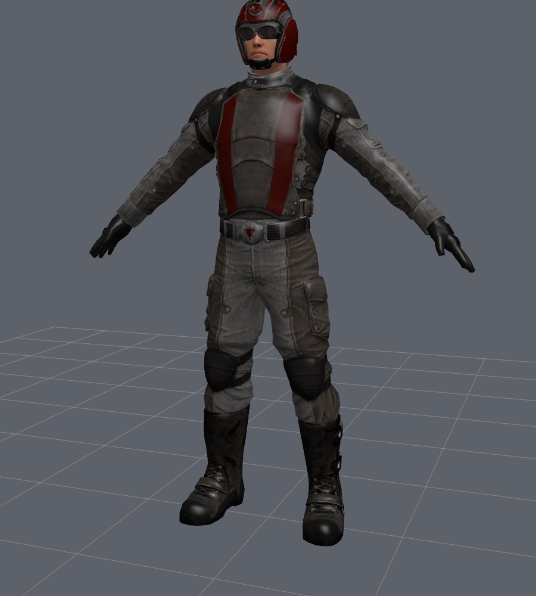
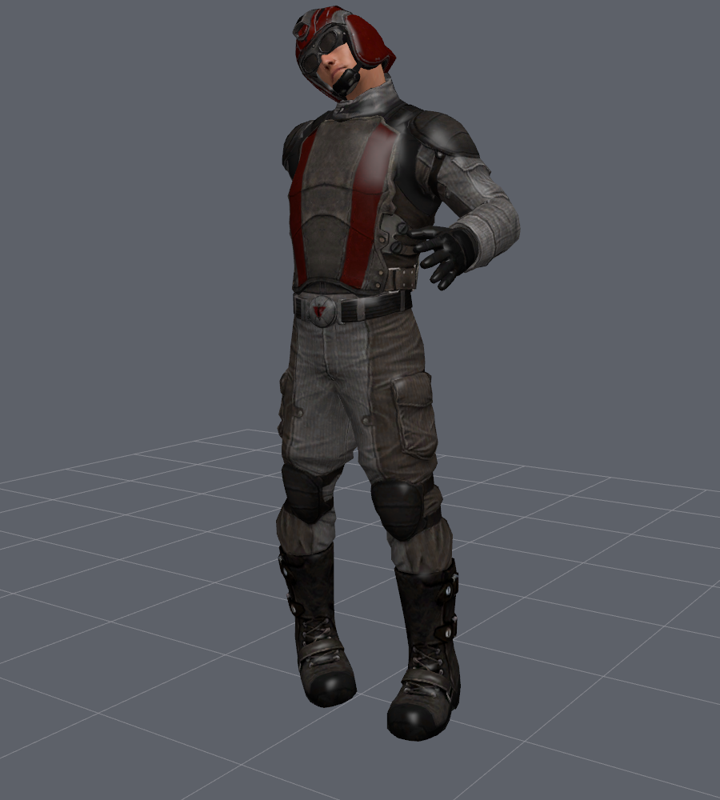
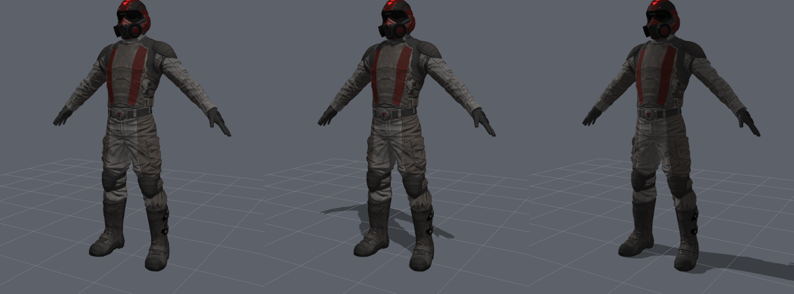

# PlanetStudio

*[Version française](README.md)*

An animation studio written in pure Rust, in the spirit of Source Filmmaker, that works directly with
PlanetSide 2 models (Forgelight engine). There is nothing to extract by hand: the software reads the
game's `.pack2` archives.

 

## Table of contents

- [Language](#language)
- [Build and run](#build-and-run)
- [Installing PlanetSide 2 (2019 version)](#installing-planetside-2-2019-version)
- [Updates](#updates)
- [Features](#features)
  - [Controls](#controls)
- [License](#license)

## Language

The interface is available in English and French. On first launch, PlanetStudio follows the
language of Windows (French for a French Windows, English otherwise). Change it any time from the
**🌐 Langue / Language** menu; the choice is saved in `%APPDATA%/PlanetStudio/config.json`.

This page covers installing and using the studio. The detailed technical documentation (file
formats, architecture, command-line tools) is in the [French README](README.md).

## Build and run

```bash
cargo run --release -p planet-studio
```

On first launch, PlanetStudio asks for the folder of the 2019 version of PlanetSide 2 (**Browse…**
button). It never searches your disk for the game on its own. The path is saved in
`%APPDATA%/PlanetStudio/config.json` and can be changed from **File > Change game folder…**.
PlanetStudio then indexes the file names once (about 77,000 names) and caches them in
`%APPDATA%/PlanetStudio/namelist.txt`.

## Installing PlanetSide 2 (2019 version)

PlanetStudio reads the files of the 2019 version of the game. It does not ship any game files:
everyone downloads that version from their own Steam account (PlanetSide 2 is free to play). This copy
is only used as a source of models; it does not connect to the servers, and your usual install of the
game is not touched.

1. Add PlanetSide 2 to your Steam library (free), without necessarily installing it.
2. Open the Steam console: type `steam://open/console` in your browser's address bar, or in
   **Run** (Win + R).
3. In the console, type:
   ```
   download_depot 218230 218231 1787788619403479665
   ```
4. When it finishes, Steam shows the folder where it saved the files (in
   `Steam\steamapps\content\app_218230\depot_218231`). Move that folder wherever you like, for example
   `D:\Games\PlanetSide 2 (2019)`.
5. Start PlanetStudio, click **Browse…** and pick that folder.

PlanetStudio is not affiliated with Daybreak Game Company. PlanetSide 2 and its content belong to
their respective owners.

## Updates

On startup, PlanetStudio asks GitHub whether a newer version exists in the
[Releases](https://github.com/WowiLoveSchwepps/PlanetStudio/releases). Nothing is installed without
your consent: a banner offers **Update**, **Later** or **Skip this version**. The update downloads the
archive, checks its SHA-256 checksum, replaces the executable, and takes effect on restart. The check
can be turned off in **Help > Check on startup**. A version built from source never updates itself.

## Features

- **Asset browser**: about 7,600 actors (`.adr`) and 12,700 models (`.dme`), with search and
  categories (characters, weapons, vehicles, base objects, scenery). Base objects (terminals,
  shields, IFF doors, spawn tubes, capture points…) are added by hand, like a character.
- **Soldier creator**: pick the faction (TR, NC, VS or NSO), sex, class and face, then armor,
  helmet, camo and decal.
- **Posing and animation**: rotation and translation gizmos, keys on a timeline with smooth,
  linear or stepped interpolation, markers, in/out points, pose copy-paste (including mirrored).
- **Game animations**: the soldiers' clips from `ThirdPerson.mrn` (running, shooting, emotes,
  deaths…), blended or added on top, plus **Mixamo FBX** imports and group dances.
- **Two cameras**: a free work camera for posing, and a shot camera for photos and videos, which
  can be animated with keys, preset moves (orbit, arc, spiral, dolly, crane) or live recording.
- **Map scenery**: load a place from Indar, Amerish, Esamir, Hossin… with terrain, vegetation,
  the map's sky at any hour, fog, sun rays, scenery lamps and ambient particles.
- **Rendering**: shadows, ambient occlusion, bloom, depth of field, color grading, film grain;
  graphics quality presets from Preview to Final render.
- **Export**: H.264 or AV1 MP4 video (built-in encoders, or ffmpeg with GPU encoders if you choose
  to download it), animated GIF, image sequences and photos, with supersampling and an export
  queue.



### Controls

The **Help** menu opens a window with three tabs: *Getting started* (six steps, with the keys
currently set), *Mouse and cameras*, and *Shortcuts*, where every key can be changed: click the key,
then press the new one (Esc cancels, right click clears). Each action accepts two keys. Movement keys
are read by their position on the keyboard, so W/A/S/D on QWERTY is Z/Q/S/D on AZERTY.

The camera flies like a drone or a game's spectator camera: hold the right mouse button to look
around, and use W/A/S/D to fly in the direction you look. The 🚁 menu at the top of the viewport sets
speed, mouse sensitivity, inertia and vertical inversion.

Default keys (QWERTY positions):

| Action | Control |
|---|---|
| Look around (free flight) | right mouse button held (cursor hidden) |
| Fly | W/A/S/D, Q/E while holding the right button or PgDn/PgUp to go down/up, Shift = faster |
| Flight speed | right click + wheel, or the viewport's 🚁 menu |
| Step forward / back | wheel |
| Orbit around the target point | Alt + left click |
| Pan the view | middle click, or Alt + Shift + click |
| Play / pause | Space |
| Previous / next frame | Left / Right arrow |
| Set a key | K |
| Rotation / translation gizmo | E / W |
| Frame the selection | F |
| Work / shot camera | C |
| Photo from the shot camera | P |
| Undo / redo | Ctrl+Z / Ctrl+Y (or Ctrl+Shift+Z) |
| Delete the selected actor | Del |
| Save | Ctrl+S |

## License

PlanetStudio is free software, distributed under the
[GNU GPL version 3 or later](LICENSE): you may use, study, modify and redistribute it, provided that
any redistributed version (modified or not) stays under the same license, with its source code. It
comes with no warranty.

The libraries it uses keep their own licenses (MIT, Apache-2.0, BSD, Zlib…). Their texts are included
with each Release in `THIRD_PARTY_LICENSES.txt`. PlanetSide 2 files are not part of the project and
belong to Daybreak Game Company.
