# PlanetStudio

*[English version](README.en.md)*

Studio d'animation en Rust pur, dans l'esprit de Source Filmmaker, qui utilise directement les modèles
de PlanetSide 2 (moteur Forgelight). Il n'y a rien à extraire à la main : le logiciel lit les archives
`.pack2` du jeu.

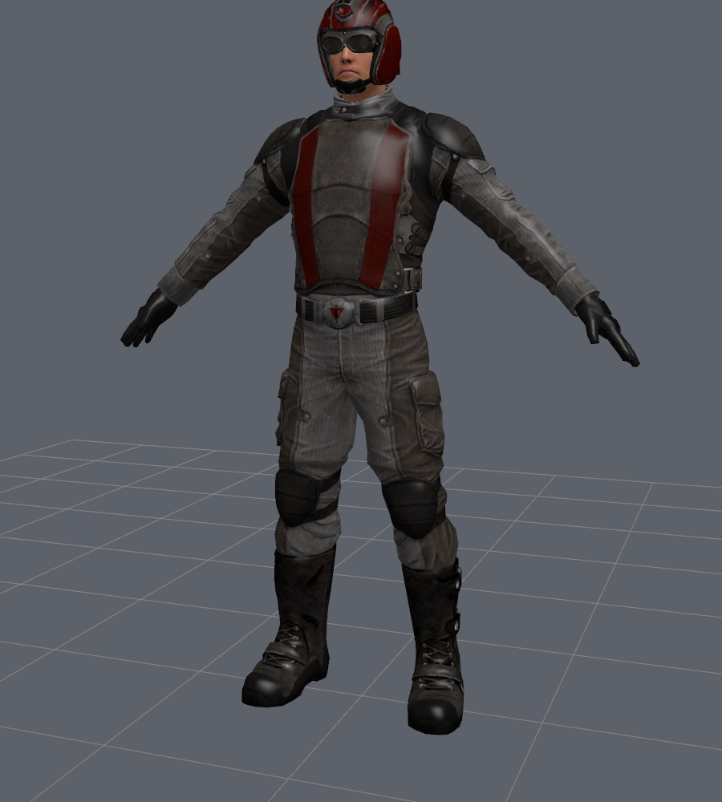 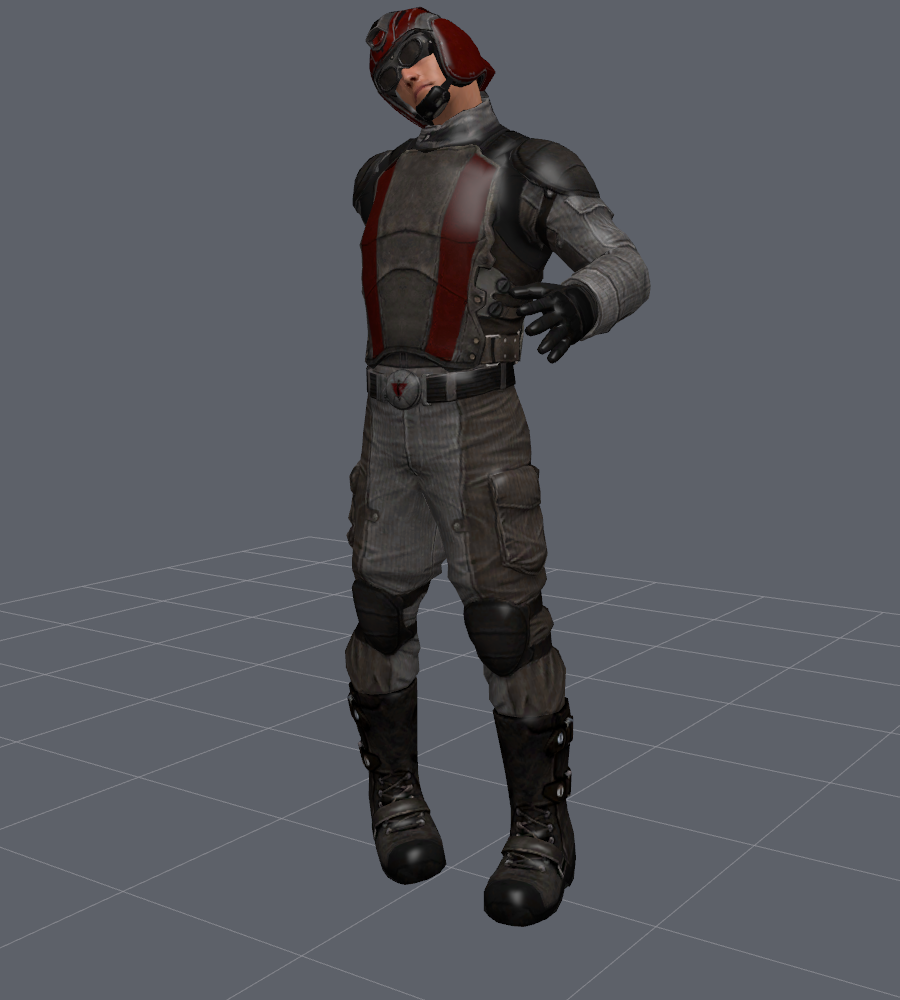

## Table des matières

- [Compiler et lancer](#compiler-et-lancer)
- [Installer PlanetSide 2 (version 2019)](#installer-planetside-2-version-2019)
- [Mises à jour](#mises-à-jour)
- [Fonctionnalités](#fonctionnalités)
  - Assets et personnages : [navigateur d'assets](#navigateur-dassets),
    [objets de base](#objets-de-base), [créer un soldat](#creer-un-soldat),
    [liens entre acteurs](#liens-entre-acteurs), [camouflages](#camouflages),
    [décalcomanies](#decalcomanies)
  - Pose et animation : [pose](#pose), [déplacer un personnage](#deplacer-un-personnage),
    [copier-coller de pose](#copier-coller-de-pose), [grille au sol](#grille-au-sol),
    [timeline](#timeline), [animations du jeu](#animations-du-jeu),
    [mélange d'animations](#melange-danimations), [animations FBX (Mixamo)](#animations-fbx),
    [danses de groupe](#danses-de-groupe)
  - Caméras et image : [deux caméras](#deux-cameras), [caméra prédéfinie](#camera-predefinie),
    [photo](#photo), [post-traitement](#post-traitement), [fenêtre Exporter](#fenetre-exporter)
  - Rendu et lumière : [matériaux du jeu](#materiaux-du-jeu),
    [qualité graphique](#qualite-graphique), [soleil](#soleil), [ombres](#ombres),
    [ambiances](#ambiances)
  - Cartes : [décor des cartes](#decor-des-cartes) (terrain, flore, eau, ciel, brouillard, lampes,
    particules)
  - Projets : [annuler / rétablir, sauvegarde](#annuler-retablir)
  - [Contrôles](#contrôles)
- [Outils en ligne de commande](#outils-en-ligne-de-commande)
- [Architecture](#architecture)
  - [Formats décodés](#formats-décodés)
- [Limites actuelles et pistes](#limites-actuelles-et-pistes)
- [Licence](#licence)

## Compiler et lancer

```bash
cargo run --release -p planet-studio
```

Au premier lancement, PlanetStudio demande le dossier de la version 2019 de PlanetSide 2 (bouton
**Parcourir…**). Il ne cherche jamais le jeu tout seul sur le disque. Le chemin est retenu dans
`%APPDATA%/PlanetStudio/config.json` et se change dans **Fichier > Changer de dossier de jeu…**.
PlanetStudio indexe ensuite les noms de fichiers une seule fois (environ 77 000 noms), puis les garde
en cache dans `%APPDATA%/PlanetStudio/namelist.txt`.

L'interface existe en français et en anglais. Au premier lancement, elle suit la langue de Windows ;
elle se change dans le menu **🌐 Langue / Language** (choix retenu dans `config.json`).

## Installer PlanetSide 2 (version 2019)

PlanetStudio lit les fichiers de la version 2019 du jeu. Il ne fournit aucun fichier du jeu : chacun
télécharge cette version depuis son propre compte Steam (PlanetSide 2 est gratuit). Cette copie sert
seulement de source de modèles ; elle ne se connecte pas aux serveurs, et ton installation habituelle
du jeu n'est pas touchée.

1. Ajoute PlanetSide 2 à ta bibliothèque Steam (gratuit), sans forcément l'installer.
2. Ouvre la console Steam : tape `steam://open/console` dans la barre d'adresse de ton navigateur, ou
   dans **Exécuter** (Win + R).
3. Dans la console, tape :
   ```
   download_depot 218230 218231 1787788619403479665
   ```
4. Steam indique à la fin le dossier où il a enregistré les fichiers (dans
   `Steam\steamapps\content\app_218230\depot_218231`). Déplace ce dossier où tu veux, par exemple
   `D:\Jeux\PlanetSide 2 (2019)`.
5. Lance PlanetStudio, clique sur **Parcourir…** et choisis ce dossier.

PlanetStudio n'est pas affilié à Daybreak Game Company. PlanetSide 2 et ses contenus appartiennent à
leurs propriétaires respectifs.

## Mises à jour

Au démarrage, PlanetStudio demande à GitHub s'il existe une version plus récente dans les
[Releases](https://github.com/WowiLoveSchwepps/PlanetStudio/releases). Rien ne s'installe sans ton
accord : un bandeau propose **Mettre à jour**, **Plus tard** ou **Ignorer cette version**. La mise à
jour télécharge l'archive, vérifie son empreinte SHA-256, remplace l'exécutable, puis s'applique au
redémarrage. La vérification se désactive dans **Aide > Vérifier au démarrage**. Une version compilée
depuis les sources ne se met jamais à jour toute seule.

Publier une version : mettre la version de `Cargo.toml` à jour, puis pousser un tag (`git tag v0.2.0`,
`git push origin v0.2.0`). Le workflow `.github/workflows/release.yml` compile, publie l'archive et
son empreinte.

## Fonctionnalités

- <a id="navigateur-dassets"></a>**Navigateur d'assets** : environ 7 600 acteurs (`.adr`) et 12 700 modèles (`.dme`), avec recherche et
  catégories (personnages, armes, véhicules, objets de base, décor).
- <a id="objets-de-base"></a>**Objets de base** (catégorie du navigateur, avec un filtre TR / NC / VS / neutres) : environ
  570 terminaux (équipement, véhicules, avions, warpgate), boucliers et portes IFF, tubes de
  réapparition, générateurs, points de capture, tubes de gravité… Le jeu ne les place pas dans
  les cartes : c'est le serveur qui les fait apparaître, et le décor chargé d'une carte ne les
  contient donc pas. On les ajoute à la main, comme un personnage.
  - Près de 3 400 de ces acteurs ne sont cités par aucun fichier du client, et leur nom est donc
    inconnu. On le devine à partir des fichiers qu'ils citent (modèle, palette, textures), puis
    on le vérifie par le hash de l'index. Les noms trouvés sont gardés dans
    `%APPDATA%/PlanetStudio/namelist_acteurs.txt`.
  - La **palette** `.dma` de l'acteur est appliquée : elle donne les variantes de faction d'un
    même modèle (écran rouge `TREquipmentTerminal.dds` d'un terminal `_TR`, couleur d'un
    bouclier).
  - Les **champs de force** (matériaux `ForceField*` : boucliers, portes IFF, dôme de la
    warpgate) sont translucides et lumineux, à la couleur de faction de leur palette (TR rouge,
    NC bleu, VS violet), avec un réseau d'hexagones qui s'efface de loin. Ils ne projettent pas
    d'ombre.
  - Les téléporteurs du jeu ne sont qu'un effet de particules (`TeleportTube_*.xml`), sans
    modèle : ils ne sont pas disponibles.

  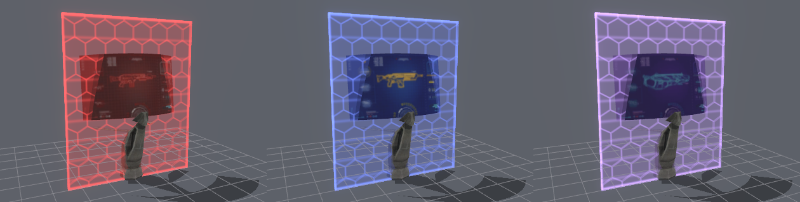
- <a id="creer-un-soldat"></a>**Créer un soldat** : choisissez la faction (TR, NC, VS ou NSO), le sexe, la classe et le visage. Le
  logiciel assemble l'armure, la tête et le casque, et fusionne leurs squelettes.
  Comme dans le jeu, un casque intégral (`<CoveredSlots name="CustomizationHead"/>` dans son
  `.adr`, ex. la cagoule de l'infiltré TR) masque la tête du même personnage ; la tête réapparaît
  si on masque ou retire le casque.
  Les robots NSO s'appellent « Common » dans les fichiers du jeu. Un robot se compose de trois
  éléments fusionnés : le corps `Armor_Common_Male_Skins_Base`, l'armure de classe
  `Armor_Common_Male_Skins_<classe>_001` et la tête-caméra `Helmet_Common_Male_All_Look001`. La
  recherche « nso » ou « robot » les retrouve.
  - **MAX** (classe « MAX », hommes seulement, sans visage) : l'exosquelette a son propre
    squelette. Le corps est `Armor_<faction>_Male_Max_Look001` (robot NSO :
    `Armor_Common_Male_MAX_Base`, le Defector, avec l'armure `Armor_Common_Male_Skins_MAX_001` ;
    la recherche « defector » le retrouve), coiffé de
    `Helmet_<faction>_Male_Max_Look001` (NSO : `Helmet_Common_Male_All_MAX_001`). Une arme
    anti-infanterie est liée à chaque bras, sur les os `L_WEAPON` et `R_WEAPON`
    (`Weapon_<faction>_MaxAntiInfantryLeft001` / `Right001`) ; le Defector NSO garde ses mains,
    sans arme. On peut changer d'arme ou en lier une au Defector (autre arme
    MAX `Weapon_*_Max*`) avec un lien « os ». Les listes Armure et Casque proposent les
    améliorations `Look001UpgradeNN` (Auraxium, Holographic…), les skins Havoc, Sigma, Darkstar…
    et les casques MAX.
  - **Skins** (listes Armure et Casque du panneau) : toutes les pièces d'armure et tous les
    casques du jeu pour la faction, le sexe et la classe choisis, soit environ 1 960 modèles en
    tout (armures `Look00x`, `Upgrade`, Auraxium, Holographic, Gold, variantes de biome, skins
    `Armor_<faction>_Skins_*` comme PS_AVA, Arbiter, Havoc ou Operative ; casques de classe et
    casques `All`, casquettes, éditions spéciales ; pour les robots NSO, armures SecurityForce et
    Aurax et têtes Bot, Operative…). Chaque liste a un filtre (plusieurs mots possibles :
    « auraxium look001 ») et le bouton 🎲 tire armure et casque au hasard ; ↺ revient au
    soldat par défaut. Une pièce d'armure se pose par-dessus la combinaison de base de la
    classe, qui garde bottes et gants. La classe « Base » propose les armures de toutes les
    classes. Les pièces de MAX n'apparaissent que pour la classe MAX ; les modèles d'interface
    `*_UI` et les casques NSO féminins (le robot n'a qu'un corps masculin) ne sont pas proposés. La troupe de danseurs garde l'équipement par
    défaut.
  - **Changer les skins d'un soldat existant** (inspecteur, section Skins) : sélectionnez le
    corps ou l'une de ses pièces. Les mêmes listes Armure et Casque, plus « Aucune » / « Aucun
    casque » et 🎲, remplacent la pièce fusionnée sur le corps. La nouvelle pièce reprend le
    camouflage et la décalcomanie du corps, et le remplacement s'annule en un seul Ctrl+Z.
    La section apparaît pour tout acteur dont le corps est une tenue de base de soldat
    (`Armor_<faction>_<sexe>_<classe>_Base`, `…_StealthBase`, robot `Armor_Common_Male_Skins_Base`)
    ou un corps de MAX (`Armor_<faction>_Male_Max_Look001`, `Armor_Common_Male_MAX_Base`).
- <a id="liens-entre-acteurs"></a>**Liens entre acteurs** :
  - *Fusion d'os* (comme le bonemerge de Source) : tête, casque ou pièces d'armure suivent le squelette
    de l'acteur parent.
    Chaque os de même nom reprend la déformation de celui du parent (matrice monde × liaison
    inverse), pas sa matrice monde : environ 290 pièces (casquettes `CommissarHat`,
    `Look005Upgrade*`…) viennent d'un squelette aux orientations de liaison différentes, et
    sortaient tournées de 90° devant le visage.
  - *Attache à un os* : par exemple une arme sur `R_WEAPON`.
- <a id="pose"></a>**Pose** : un gizmo de rotation (anneaux par axe local, plus un anneau de rotation libre) et un gizmo
  de translation. L'inspecteur permet aussi de taper les angles. On sélectionne un os en cliquant sur une
  articulation ou dans l'arbre des os.
- <a id="deplacer-un-personnage"></a>**Déplacer un personnage à la souris** : clic gauche tenu sur son corps, puis glisser. Il glisse
  sur le sol en restant sous le curseur, même si un os était sélectionné (`Ctrl` : aimanté aux
  carreaux de la grille, dans son orientation). Un clic simple sélectionne toujours une articulation.
- <a id="copier-coller-de-pose"></a>**Copier-coller de pose** : `Ctrl+C` copie la pose du personnage sélectionné, `Ctrl+V` la colle sur
  un autre personnage à l'image courante (`Ctrl+Maj+V` : en miroir gauche / droite). Les mêmes
  commandes sont dans le menu Édition, dans l'inspecteur et au clic droit sur un personnage de la
  liste Scène. « Coller l'animation » recopie toutes les clés des os, pas seulement l'image
  courante. « Coller la position » place le personnage à l'endroit et dans l'orientation de celui
  qui a été copié (sans toucher à sa pose ni à son échelle). Entre un homme, une femme ou un robot, la pose garde les longueurs d'os du personnage
  qui la reçoit.
- <a id="grille-au-sol"></a>**Grille au sol orientable** : Affichage > Grille > Rotation (glisser, taper un angle, pas de
  15°), ou « Aligner sur le personnage sélectionné ». « Placer sous le personnage sélectionné »
  (touche G) pose la grille à ses pieds, sur un toit ou un étage ; à l'inverse, « Poser le
  personnage au centre de la grille » amène ses pieds au centre de la grille (clé à l'image
  courante, sans changer son orientation) ; « Hauteur » l'ajuste et
  « Origine » la ramène en (0, 0, 0). Angle et position sont enregistrés avec le projet.
- <a id="timeline"></a>**Timeline à images clés** : chaque modification pose une clé à l'image courante. Trois
  interpolations sont proposées (lissée, linéaire, palier). Les clés se déplacent par glisser et se
  suppriment par clic droit. On peut aussi poser une clé sur toute la pose, lire en boucle et changer
  le nombre d'images par seconde.
- <a id="animations-du-jeu"></a>**Animations du jeu** (onglet « 🏃 Animations du jeu ») : environ 1 300 clips de `ThirdPerson.mrn`
  (courses, tir, recharges, morts, véhicules, emotes…), avec recherche et filtre par catégorie.
  Un clic prévisualise le clip en boucle sur le personnage sélectionné. Le bouton « Écrire dans la
  timeline » le convertit en clés, avec un réglage de vitesse et de répétitions. On peut aussi ne
  garder qu'une seule pose. Les clés obtenues se retouchent ensuite à la main.
  Avec « Déplacement », la trajectoire du clip est appliquée à la position de l'acteur :
  une course avance réellement (environ 4 m/s), un virage tourne, et les répétitions
  s'enchaînent bout à bout.
- <a id="melange-danimations"></a>**Mélange d'animations** (section « Mélange » de l'onglet Animations) :
  - *Remplacer* : le clip remplace l'animation existante, selon un poids réglable de 0 à 1 et avec
    des fondus d'entrée et de sortie exprimés en images ;
  - *Superposer* : le clip s'ajoute par-dessus l'animation déjà présente. C'est le mode des clips
    « Additive » du jeu (recul, visée) ;
  - *Partie du corps* : tout le corps, le haut (de SPINELOWER vers le haut) ou le bas. On peut par
    exemple garder les jambes d'une course et mettre une tenue de fusil sur le haut du corps.

  Le mode et la partie du corps sont choisis automatiquement d'après le nom du clip
  (`_Additive`, `_PartialUpper`).
- <a id="animations-fbx"></a>**Animations FBX (Mixamo)** (onglet Animations, section « 🎞 Animations FBX ») : on importe une
  animation de [Mixamo](https://www.mixamo.com) et elle est transférée sur le squelette du soldat.
  À l'export Mixamo, choisissez le format *FBX Binary* et *Without Skin* (la cadence 30 ou 60 i/s
  n'a pas d'importance). Un export *With Skin* marche aussi : le maillage est ignoré, et des deux
  prises du fichier (« Take 001 », vide, et « mixamo.com ») on garde celle qui est animée.
  - Pour importer : glissez le `.fbx` sur la fenêtre, cliquez sur un fichier proposé (ceux de
    Téléchargements et de `Documents/PlanetStudio`), ou collez son chemin puis « Importer ».
  - Le clip importé se comporte comme ceux du jeu : aperçu en boucle, vitesse, répétitions, poids,
    fondus, partie du corps, puis « Écrire dans la timeline ».
  - Le déplacement du bassin (Hips) est conservé, mis à l'échelle de la longueur des jambes du
    soldat. Pour une marche ou une course sur place, cochez *In Place* sur Mixamo.
  - Les noms d'os Mixamo (`mixamorig:Hips`, `LeftArm`…) et Unreal (`pelvis`, `spine_01`, `thigh_l`,
    `upperarm_r`, `index_01_l`…, fréquents sur Sketchfab) sont reconnus. Si l'avant-bras ou le
    tibia porte un autre nom (`upperarm_twist_01_r`, `RightUpLegTwist`), on prend le parent de la
    main ou du pied. Les FBX texte (ASCII) ne sont pas lus.

  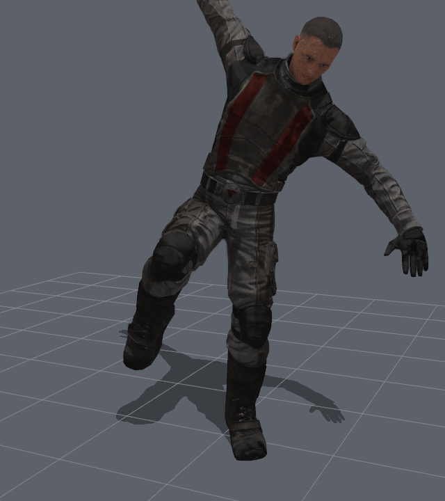
- <a id="danses-de-groupe"></a>**Danses de groupe** (en haut de l'onglet Animations) : on choisit la danse dans la liste
  « Danse », soit la danse du cheval, soit l'une des animations FBX importées.
  - La « danse du cheval » est calculée par cinématique inverse. On place les pieds et les mains,
    et le squelette suit. Elle contient le rebond sur chaque temps, des appuis alternés, des poings
    croisés comme sur des rênes, et le lasso au-dessus de la tête tous les 8 temps. Le tempo et la
    durée sont réglables. Elle fonctionne sur tous les personnages, robots NSO compris.
  - Une danse FBX est transférée sur le squelette de chaque personnage (homme ou femme), et peut être
    répétée plusieurs fois à la suite.
  - « Faire danser » : le personnage sélectionné. « Faire danser tous les personnages » : toute la
    scène danse en même temps.
  - « Créer une troupe » : de 2 à 24 soldats aux factions mélangées (TR, NC, VS, NSO), avec classes,
    sexes et visages variés, placés en formation en V et qui dansent dès leur chargement.
- <a id="deux-cameras"></a>**Deux caméras**, comme dans Source Filmmaker :
  - la *caméra de travail* 🛠 : libre, pour poser et régler la scène, jamais rendue ;
  - la *caméra de prise* 🎥 : celle qui fait la photo et la vidéo. Elle existe toujours (fixe) et
    devient animée dès qu'on lui pose une clé.

  On bascule de l'une à l'autre avec C ou les boutons en haut de la vue. En vue « Prise », l'orbite,
  la molette, le déplacement et F pilotent la caméra de prise ; si elle est animée, chaque mouvement
  pose une clé à l'image courante. Le cadre affiché correspond exactement à l'image exportée
  (le hors-champ est assombri). En vue de travail, la caméra de prise est dessinée (pyramide cyan)
  et un moniteur en haut à droite montre ce qu'elle filme ; un clic dessus y fait passer.
  « 📷 Placer la prise ici » met la caméra de prise à la place de la vue de travail.
- <a id="camera-predefinie"></a>**Caméra prédéfinie** (bouton « 🎞 Caméra prédéfinie » en haut de la vue) : une fenêtre en
  trois étapes pour créer un mouvement de caméra tout prêt autour d'un personnage.
  1. *Personnage filmé* : le personnage sélectionné (ou le seul de la scène ; une tête, un casque
     ou une arme renvoient au corps qui les porte).
  2. *Mouvement* : tour à 360°, demi-tour 180°, arc 90°, spirale montante, travelling avant /
     arrière, grue, ou plan fixe (la caméra se place sans bouger).
  3. *Réglages* (enregistrés) : cadrage (gros plan visage, gros plan pieds, plan taille, en pied,
     large), champ de
     vision (celui de la caméra de prise, ou réglé pour le plan), distance (automatique : celle
     qui donne le cadrage avec ce champ de vision ; ou réglée en mètres), hauteur
     (contre-plongée, à hauteur, plongée, vue du dessus), côté de départ, sens, durée, vitesse
     douce ou constante (un tour à 360° à vitesse constante boucle sans à-coup), suivi du
     personnage s'il bouge, effacement des anciennes clés de caméra (sinon le mouvement est
     inséré à l'image de début, avec une coupe franche avant et après), image de début (celle de
     la tête de lecture à l'ouverture, modifiable).

  **Aperçu en direct** : tant que la fenêtre est ouverte, la caméra de prise (vue Prise, moniteur
  et pyramide de visée de la vue de travail) montre le plan calculé avec les réglages du moment ;
  changer un réglage passe en vue Prise. « ▶ Lire l'aperçu » le joue depuis son début. Rien
  n'est écrit avant OK : Annuler ou fermer la fenêtre rend la caméra d'avant, et les exports
  utilisent toujours la vraie caméra. Piloter ou modifier la caméra de prise à la main met
  l'aperçu en pause jusqu'au prochain changement de réglage.

  Un résumé dit ce qui va se passer ; **OK** écrit sur la caméra de prise exactement la piste de
  l'aperçu (une clé tous les 10° au plus, la spline reste sur le cercle) et passe en vue
  Prise : Espace pour voir le mouvement. Les clés restent modifiables ; Ctrl+Z annule.
  « 🗑 Effacer toutes les clés de caméra », en bas de la fenêtre, rend la caméra de prise fixe.
- <a id="photo"></a>**Photo** (P, ou Fichier > Prendre une photo) : l'image courante vue par la caméra de prise, avec
  les réglages de l'onglet Image de la fenêtre Exporter (format, nom, taille), jusqu'à
  15360×8640. Les grandes images sont rendues par tuiles : une
  4K suréchantillonnée 3× ou 4×, ou une 8K, ne dépasse plus la mémoire de la carte graphique.
  L'image entière est d'abord rendue en réduit : l'occlusion ambiante y retrouve ce qui est hors
  de la tuile, sans quoi chaque bord de tuile s'éclaircirait d'un coup près d'un personnage.
- <a id="post-traitement"></a>**Post-traitement** (Affichage > 🎨 Post-traitement…, enregistré dans le projet ; la vue, les
  photos et les vidéos l'utilisent) :
  - étalonnage : exposition, rendu des tons (écrêtage d'origine, filmique doux qui n'adoucit que
    les hautes lumières, ACES contrasté, AgX), contraste, saturation, température et teinte ;
  - **étalonnage du jeu selon l'heure** : avec le ciel d'une carte, le rendu des tons et la
    table d'étalonnage du jeu à l'heure du ciel (plein jour, coucher, nuit) remplacent le rendu
    des tons choisi (voir `<Post>` dans « Ciel » plus bas) ;
  - objectif : vignettage, grain de pellicule (un grain par pixel de l'image exportée, qui change
    à chaque image d'une vidéo) et netteté ;
  - profondeur de champ : mise au point sur la cible de la caméra (elle suit la caméra animée)
    ou à une distance donnée, et flou de l'arrière-plan en % de la hauteur de l'image (même
    rendu quelle que soit la taille d'export) ;
  - trois ambiances toutes prêtes : **Neutre** (l'image telle que rendue), **Cinéma** et
    **Jeu (live)**. Cette dernière est calée sur des captures d'Indar du serveur live (désert,
    canyons, savane au coucher), comparées à des rendus du studio aux mêmes heures : étalonnage
    du jeu selon l'heure, +0,5 IL, contraste 1,08, saturation 1,2, température −0,2, teinte +0,9
    (magenta). Le jeu n'écrête pas le sable du désert (le studio neutre le brûle) et son image
    tire vers le rose-lavande : sol rouge-orangé, ombres violacées, ciel pervenche. Elle va avec
    le ciel, le brouillard et le voile de la carte, et l'ambiance Indar.

    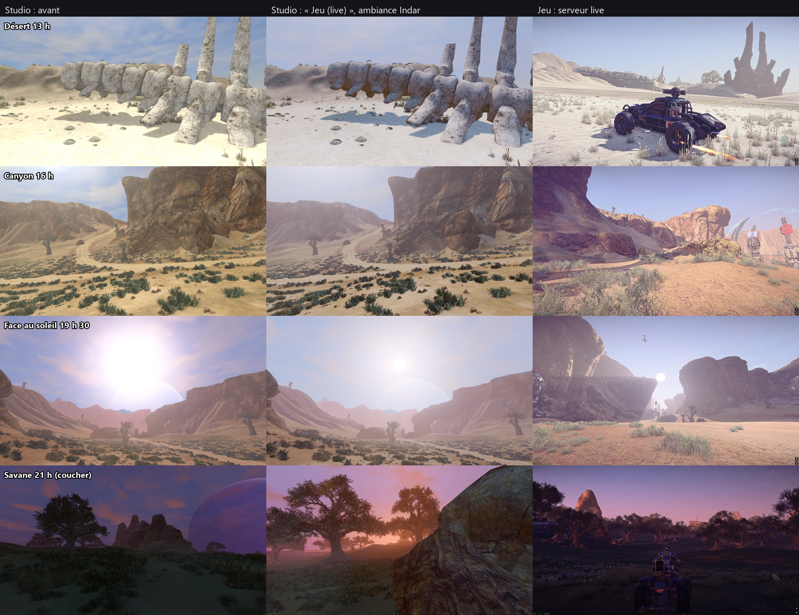
- <a id="materiaux-du-jeu"></a>**Matériaux du jeu** : en plus de la couleur (`_C`), le rendu utilise les cartes du jeu :
  - `_N`, le relief (normal map) : coutures, plaques, rivets ;
  - `_S`, la brillance : métal, brillance et occlusion des reflets ;
  - le canal B de `_S`, les zones lumineuses : LED, emblèmes et voyants des armes.
    Leur couleur est celle de `_C` seule (ni camouflage, ni détail répété) ; une LED peinte
    sombre et saturée (turquoise VS, rouge TR, jaune NC) est ramenée vers sa pleine intensité, puis
    portée au-delà du seuil du bloom (×4) : elle brille en néon, auréolée. L'occlusion ambiante
    n'assombrit pas ces lumières.

  Le relief et les lumières se coupent dans la fenêtre Qualité graphique (et en capture avec
  `--no-relief` et `--no-emissive` ; `--emissive 1.5` règle leur intensité).
- <a id="qualite-graphique"></a>**Qualité graphique** (Affichage > ⚙ Qualité graphique…), dans l'esprit des options du jeu :
  - **anticrénelage** : MSAA (désactivé, 2×, 4× ou 8× selon la carte graphique), **FXAA** sur
    l'image finale (en plus du MSAA, ou à sa place) et **reflets lissés** (les reflets du soleil
    ne scintillent plus sur le relief fin, les courbures et l'eau lointaine) ;
  - résolution de la vue (50 à 200 %), ombres (désactivées,
    basse 1024 à bords nets, moyenne 2048, haute 4096, ultra 4096 avec bords plus doux) ;
  - textures (pleine résolution, ou 1/2, 1/4, 1/8), relief et lumières des textures (avec leur
    intensité, 0 à 3), luminosité ;
  - **filtrage bicubique des gros plans** : là où un texel couvre plusieurs pixels, la couleur,
    le relief et la brillance sont filtrés en Catmull-Rom au lieu du bilinéaire (plus de
    losanges ni de flou en escalier) ;
  - **netteté des textures** : dans une image suréchantillonnée (export, vue au-delà de 100 %),
    des niveaux de texture plus fins sont lus (jusqu'à un niveau de mip) ;
  - **bloom** : halo autour des zones très lumineuses (LED, emblèmes, voyants des armes) ;
  - **occlusion ambiante** : assombrissement des creux (aisselles, plis, dessous des plaques),
    avec son rayon ;
  - **particules** : nombre de particules d'ambiance (×0,5 à ×1,5, en plus de la densité du décor) ;
  - **terrain** : distance jusqu'où le détail du sol et de la roche est visible (60 à 350 m) ;
  - **flore** : en qualité haute, les bords des feuillages sont lissés par le MSAA (« alpha to
    coverage ») et le feuillage reste garni de loin ; en basse, découpe nette d'origine ;
  - **eau** : en qualité haute, houle animée (avec la timeline) qui reflète le ciel de la carte ;
    en basse, rides fixes et reflet de l'ambiance ;
  - trois préréglages : **Aperçu** (vue à 75 %, ombres moyennes, textures 1/2, sans occlusion,
    terrain et particules moyens), **Équilibré** (par défaut) et **Rendu final** (ombres et
    terrain ultra).

  Photos et vidéos utilisent « Rendu final » quelle que soit la qualité de la vue (case à
  décocher pour garder celle de la vue), avec un suréchantillonnage réglable : l'image est
  rendue 2× (par défaut), 3× ou 4× plus grande, puis réduite. Ces réglages sont des préférences de la machine,
  enregistrées avec la configuration du studio, pas dans le projet.
- <a id="camouflages"></a>**Camouflages** (inspecteur de l'acteur, section Camouflage) : aucun (couleurs d'origine), le
  camouflage par défaut de l'armure (TR : Digital, NC : African Forest, VS : Forest Greyscale) ou
  l'un des quelque 160 motifs du jeu, avec un filtre de recherche. L'échelle du motif et son
  intensité se règlent. Le choix s'applique aussi aux acteurs fusionnés (tête, casque) et peut
  être étendu à tous les personnages ; il est enregistré dans le projet. Bottes, gants, ceinture,
  genouillères et emblèmes gardent leurs couleurs, comme dans le jeu. Les combinaisons
  d'infiltrateur TR, VS et NSO ne prennent pas de camouflage : leur emplacement ne contient que
  `norm.dds` (texture de remplissage), et le masque de leur `_N` ne suit pas les pièces de la
  tenue (le motif y tombait en taches découpées au hasard). Celle du NC a le sien (AfricanForest).
- <a id="decalcomanies"></a>**Décalcomanies** (inspecteur de l'acteur, section Décalcomanie) : aucune, celle de l'armure
  (TR et NC : PowerHouse, NSO : logo NS) ou l'une des quelque 200 décalcomanies du jeu
  (`Decal_*`), avec filtre et opacité. Elle se pose sur les épaulières, comme dans le jeu, par-dessus
  le camouflage. Même propagation et même enregistrement que le camouflage.
- <a id="soleil"></a>**Soleil** (menu Affichage) : azimut, hauteur au-dessus de l'horizon, couleur et intensité,
  avec cinq préréglages (Studio, Midi, Matin, Coucher, Nuit). Un disque à rayons montre sa
  direction dans la vue de travail (désactivable) ; il n'apparaît ni dans la vue de prise ni dans
  les exports. Les réglages sont enregistrés dans le projet ; « Studio » est la lumière d'origine.
  Le soleil s'anime comme la caméra de prise : « 🔑 Clé de soleil » (menu Affichage, ou
  « ☀ Soleil » dans la timeline) pose une clé à l'image courante. Dès qu'il a des clés, tout
  réglage du soleil (préréglage compris) pose une clé à l'image courante. Les clés apparaissent
  sur la piste « ☀ Soleil » de la timeline : glisser pour déplacer, clic droit pour supprimer. Après la
  dernière clé supprimée, le soleil reste fixe là où elle le mettait. Entre deux clés, l'azimut
  tourne par le plus court chemin ; l'interpolation suit le choix de la timeline (lissée,
  linéaire, palier). Annuler / rétablir couvre les clés de soleil.
- <a id="ombres"></a>**Ombres** (menu Affichage) : le soleil projette l'ombre des personnages sur eux-mêmes, entre
  eux et sur le sol. Le sol est invisible et ne montre que l'ombre, dont l'opacité se règle
  (« Ombre au sol »). Dans un décor, cette opacité assombrit aussi le sol du décor sous l'ombre
  des personnages (et pas seulement la lumière directe du soleil), là où le soleil arrive.
  Sous une canopée dense (Hossin) ou derrière un bâtiment, un soleil bas (Matin, Coucher, Nuit)
  laisse les personnages dans l'ombre du décor : seule l'ambiance les éclaire, sans reflet du
  soleil. Décocher « Le décor ombre les personnages » les garde éclairés par le soleil (éclairage
  de cinéma) ; le sol et le décor restent ombrés. Ces réglages sont enregistrés dans le projet ;
  photos et vidéos en tiennent compte.
- <a id="ambiances"></a>**Ambiances** (menu Affichage > Ambiance) : l'éclairage d'ambiance et les reflets viennent d'un
  panorama du jeu au lieu du dôme gris du studio. Au choix : Indar (canyons), Indar (savane),
  Amerish, Esamir, Nexus, le dôme ciel bleu ou l'ambiance extérieure par défaut. Indar n'a pas
  de `indar_ambient_c.dds` : ses panoramas s'appellent `indar_canyons_c.dds` (celui que cite
  la `<Probe>` de `sky_Indar.xml`) et `indar_highlands_c.dds` (hauts plateaux, arbres de la
  savane). L'orientation (rotation du panorama) et l'intensité se
  règlent, et l'ambiance est enregistrée dans le projet. L'intensité agit aussi en mode Studio
  (dôme et lumière de remplissage), ce qui permet d'assombrir une scène de nuit.
  La couleur de fond (vue, photos, vidéos) se règle dans la même section ; elle est enregistrée
  dans le projet (« ↺ » revient au gris d'origine).
  Orientation, intensité et fond s'animent comme le soleil : « 🔑 Clé d'ambiance » dans le menu,
  puis tout réglage pose une clé à l'image courante. Les clés apparaissent sur la piste
  « 🌄 Ambiance » de la timeline (glisser, clic droit). Le choix du panorama, lui, ne s'anime pas.
- <a id="decor-des-cartes"></a>**Décor des cartes** (menu Décor > « 🗺 Choisir une carte et un lieu… ») : les bâtiments, props,
  rochers et la végétation que le jeu place sur Indar, Amerish, Esamir, Hossin, la VR, le tutoriel
  et `quickload`.
  - La vue d'ensemble de la carte est assemblée à partir des tuiles du terrain ; les objets y sont
    marqués en orangé pour repérer les bases. Un clic choisit le lieu, la molette zoome.
  - Tout ce qui se trouve dans le rayon choisi (30 à 1 000 m) est chargé en arrière-plan, avec ou
    sans la végétation. Le lieu devient l'origine de la scène, là où se trouvent les personnages.
  - La végétation comprend la flore du sol, posée par le jeu plante par plante (herbes, fougères,
    broméliacées, quenouilles, nénuphars sur l'eau d'Hossin, galets d'Amerish…) avec la teinte
    propre à chaque plante. Comme dans le jeu, elle suit la caméra : elle est posée jusqu'à 150 m
    autour de la vue de travail et de la caméra de prise (et de la caméra de l'export), où
    qu'elles aillent, et reposée quand l'une s'éloigne de 20 m.
  - Le terrain du jeu est chargé avec le décor (case « Terrain ») : relief détaillé (un point tous
    les 2 m, textures de 25 cm par pixel) dans le rayon, plus grossier (8 m) jusqu'à l'horizon,
    à 2,5 km. La hauteur du terrain au lieu choisi est ramenée à la grille : les personnages ont
    les pieds au sol. Décochez « Hauteur du sol automatique » pour la régler à la main (sur un toit
    ou un pad du Biolab, par exemple) : sur le décor déjà chargé à ce lieu, le décor, le terrain et
    le brouillard se décalent en direct pendant qu'on fait glisser la valeur, sans rechargement.
    Sans terrain, elle est estimée d'après les objets posés près du lieu.
  - Le sol prend le relief fin rangé dans les textures du terrain (une normale tous les 25 cm, plus
    précise que le maillage) et, de près (jusqu'à 110 m environ, réglable avec la qualité du
    terrain), la texture de détail de ses écosystèmes, mélangés au mètre près comme dans le jeu :
    herbe sèche ou verte, terre tassée, piste, cailloux, roche… Chaque détail garde sa couleur
    propre (brins d'herbe, graviers), rapportée à la couleur du terrain, et son relief. Il est
    projeté sur les trois axes dans les pentes. Entre deux écosystèmes, la hauteur de mélange du
    jeu fait percer les cailloux et les touffes avant les creux : la limite est découpée, pas
    fondue.
  - L'eau des décors (ruisseaux du Biolab, marais d'Hossin…) est rendue comme une surface sombre
    qui reflète le ciel de la carte, avec une houle animée (qualité « Eau » haute), ou l'ambiance
    avec des rides fixes (qualité basse).
  - Les **marais d'Hossin et d'Amerish** (matériau `SwampWater`) prennent les textures du jeu :
    la nappe d'algues jaune-vert marbrée (`Hossin_Props_Water_Algae_OC.dds`) avec son grain de
    bulles (`water_foam_algae_C.dds`), l'eau sombre et trouble entre les algues, les rides et
    les tourbillons du jeu (`water_ripple.dds`, `water_twirl90.dds`) qui glissent avec la
    timeline, et des ronds dans l'eau (gouttes, poissons) qui naissent et s'élargissent çà et
    là sur l'eau libre (qualité « Eau » haute).

    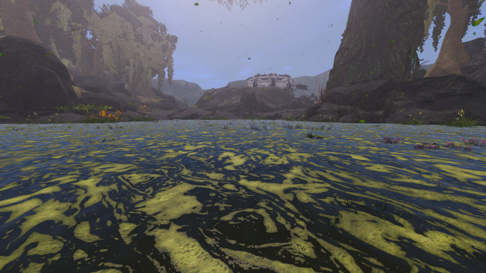
  - **Marcher dans l'eau** : un personnage qui avance dans l'eau du décor (jusqu'à 1,6 m de
    fond) l'anime comme en jeu. Derrière ses jambes, l'eau est brassée : laiteuse, couverte
    d'écume en plaques qui se clairsème et retombe en deux ou trois secondes, agitée de remous.
    Des ronds partent de ses jambes au rythme des pas et s'élargissent (en sillage en V quand il
    court). Dans les marais, il écarte les algues : le chenal ouvert, bordé d'un bourrelet
    d'algues repoussées, se referme lentement (une dizaine de secondes). Debout sans bouger, il
    ne laisse qu'une petite clairière dans les algues et de légers ronds. Sa tenue est mouillée
    sous la ligne d'eau, plus sombre et plus brillante, et plus haut quand il court
    (éclaboussures). Le sillage est relu dans la timeline : la lecture, les photos et les vidéos
    donnent le même, à n'importe quelle image.

    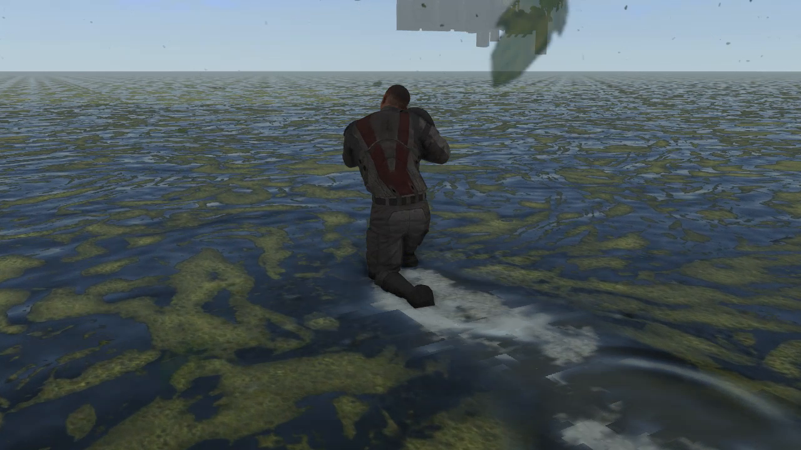
  - Le décor est dessiné par instances (une matrice par objet, un appel de dessin par modèle) et
    projette ses ombres sur les personnages. « Ombres du décor sur » règle la zone couverte par la
    carte d'ombre. Les feuillages sont découpés par l'alpha de leur texture.
  - Le ciel de la carte (dôme peint par le jeu pour chaque continent) est dessiné derrière le
    décor. Dans le menu Décor, « Ciel de la carte » l'affiche ou le masque, et le curseur
    « heure » choisit le moment de la journée : nuit, aube, plein jour ou coucher.
  - Le ciel a aussi ses **astres** et ses **nuages**, lus dans les fichiers du jeu pour chaque
    carte : le disque du soleil (la lune la nuit), les planètes (la grosse planète bleue et la
    verte d'Esamir, celles d'Indar…), les fonds d'étoiles qui s'allument la nuit, et la couche de
    nuages avec sa couleur selon l'heure (cirrus d'Indar, nuages roses à l'aube sur Esamir, aurore
    verte la nuit sur Esamir). Le disque du soleil suit la lumière du studio : il reste là où sont
    les ombres, même avec un soleil réglé à la main ou animé. Les nuages défilent avec la timeline.

  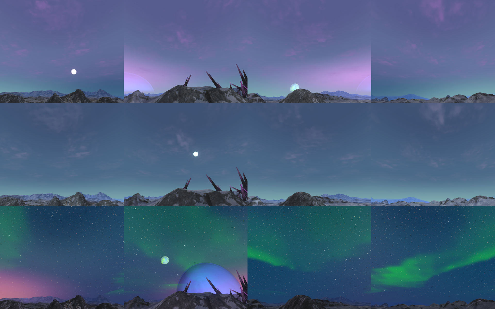 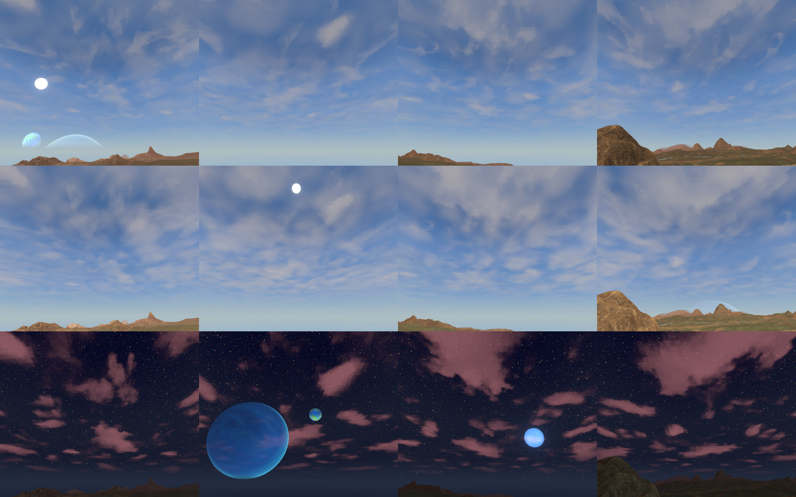
  - Avec « Le soleil suit l'heure » (coché par défaut), l'heure règle aussi le soleil comme dans
    le jeu : direction, couleur et force (la lune, bleutée et faible, la nuit), ainsi que la
    lumière ambiante. Le terrain s'assombrit donc la nuit. Si le soleil est animé, une clé est
    posée à l'image courante. Décochez pour régler le soleil à la main.
  - Avec le ciel de la carte affiché, les boutons de soleil Midi, Matin, Coucher et Nuit (lune)
    mettent le ciel à 13 h, 7 h, 20 h et 0 h (soleil qui suit l'heure) : dôme, lune, brouillard
    et étalonnage vont avec la lumière. « Studio » reste un réglage à la main.
  - « Brouillard » reprend le brouillard de la carte : plus dense près du sol, teinté par
    l'horizon et la couleur du jeu (poussière orangée sur Indar, bleutée sur Esamir), plus épais
    à l'aube et au coucher. Au loin, le décor se fond dans le ciel avant le bord du terrain
    chargé. Avec lui vient le **voile de l'air** de la carte (`<Haze>` du jeu) : le bleu du
    dôme, les nuages et les reliefs lointains pâlissent vers l'horizon, comme dans le jeu. Le
    curseur « densité » renforce ou allège les deux.
  - « Rayons du soleil » (le « Fog Shadows » du jeu) : l'air éclairé par le soleil s'illumine,
    coupé par l'ombre des arbres, des bâtiments et des personnages. Les faisceaux se voient
    surtout face au soleil ; de côté, l'air reste presque clair. Seulement dans la zone des
    ombres du décor (réglage « Ombres du décor sur »). Le curseur « force » les renforce.
  - **Halo du soleil** : autour du disque, le ciel s'éclaircit en fondu, comme dans le jeu (la
    lumière diffusée vers l'avant par l'air) : un cœur serré d'environ 2° que le bloom élargit,
    une auréole d'environ 6° et un halo large d'environ 25°, à la couleur et à la force du soleil
    (orangé au coucher, faible et bleuté autour de la lune). L'air voilé face au soleil (brouillard,
    lointain) prend aussi ce halo : contre-jour délavé.
  - **Lampes du décor** (menu Décor) : les lampes, néons et projecteurs que le jeu place sur la
    carte éclairent le sol, les bâtiments et les personnages autour d'eux, surtout visibles la
    nuit (piste des Tech Plants sous ses arches, par exemple). Les 128 plus proches de la caméra
    parmi celles qui éclairent le champ comptent (celles en limite entrent et sortent en fondu), sans ombre (leurs portées sont courtes : 10 m en médiane). Le curseur « force »
    les renforce ou les atténue ; le réglage est enregistré dans le projet.
  - **Plantes dans le vent** : arbres, buissons, fougères et herbes se balancent. Le poids de
    chaque sommet vient du jeu (couleur des sommets des feuillages et des troncs : nul au pied,
    jusqu'à 0,4 dans les couronnes ; selon la hauteur pour les herbes de la flore du sol), le
    rythme du vent de la carte (`<Wind><Sway>` de son ciel : des rafales tous les 90 m qui
    avancent à 14 m/s sur Indar, Amerish et Hossin, plus larges et plus rapides sur Esamir). Le
    shader du jeu n'étant pas dans les archives, le mouvement est reconstruit : les plantes se
    penchent dans les rafales, oscillent chacune à leur rythme et leurs feuilles frémissent. Les
    ombres suivent. Le mouvement suit la timeline (lecture, photos et vidéos identiques). Les
    curseurs « vent » et « direction du vent » du menu Particules règlent sa force (0 : plantes
    immobiles) et sa direction, même sans particules.
  - **Balises rouges** : les antennes de communication et les tours d'avant-poste ont leurs feux
    d'obstacle, lus dans les effets du jeu (`Lights_CommunicationEquip_*_red.xml`,
    `Lights_OutpostTower_red.xml`) : un point rouge au sommet du mât et au bout des bras, qui
    s'allume une demi-seconde toutes les secondes et demie et grossit avec la distance pour rester
    visible de loin (jusqu'à 800 m).
  - **Matériaux lumineux** : les bandes des portails de distorsion (`Glow`), les écrans
    holographiques des consoles et des murs de moniteurs (`BumpRigidHologram*`), les ampoules
    unies (`SimpleEmissive`) et la grille des bacs du Biolab (`GlowBlend*`) ajoutent leur lumière
    au lieu d'être éclairés comme une surface mate ; le noir y est transparent. Ils suivent
    l'intensité des zones émissives (qualité graphique). Le bouclier du stand de tir de la VR
    (`AdditiveGlow`) est dessiné comme un champ de force.
  - Le décor se masque ou se retire depuis le menu, et il est enregistré dans le projet.
  - **Particules d'ambiance** (menu Décor > Particules) : feuilles vertes qui tombent en
    tournoyant sur Hossin, vent de sable sur Indar (nuages de poussière au ras du sol, grains
    filant en traînées, brindilles sèches), neige sur Esamir (flocons proches et lointains, neige
    soufflée au sol), papillons verts lumineux sur Amerish (ils battent des ailes en tournant à
    quelques mètres du sol, et luisent la nuit). « Auto » prend l'effet du continent du décor affiché ;
    on peut aussi forcer un effet, même sans décor. La densité, la force et la direction du vent
    et la taille se règlent ; tout est enregistré dans le projet.
    - Les textures sont celles des effets du jeu (`leaves_strip_02.dds`, `Sand.dds`,
      `leaves_desert.dds`, `snow_strip.dds`, `smoke_mist.dds`, `Bugs_Butterflies_strip.dds`), et
      les tailles et vitesses reprennent les ordres de grandeur de leurs `.xml`
      (`Leaves_green_HossinTreeBig_30m_loop`, `Sand_GroundCover`, `Leaves_Desert_Blowing`,
      `Snow_Blowing_01`, `Nexus_Snow_Standard_01`, `Bugs_Butterflies_01`).
    - Les particules suivent le temps de la timeline : elles bougent pendant la lecture, sont
      figées sur une image arrêtée, et l'export vidéo montre exactement les mêmes.
    - Elles sont éclairées par le soleil et l'ambiance, reçoivent les ombres du décor et prennent
      le brouillard de la carte. Elles ne savent pas ce qui est dedans ou dehors : il neige aussi
      sous un toit (choisir « Aucune » pour une scène d'intérieur).

  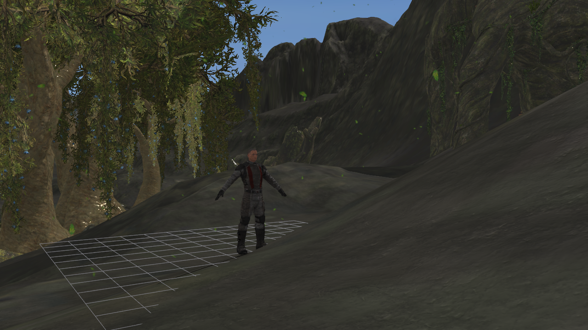 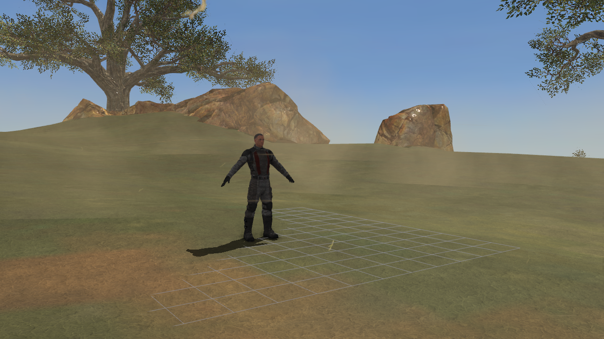
  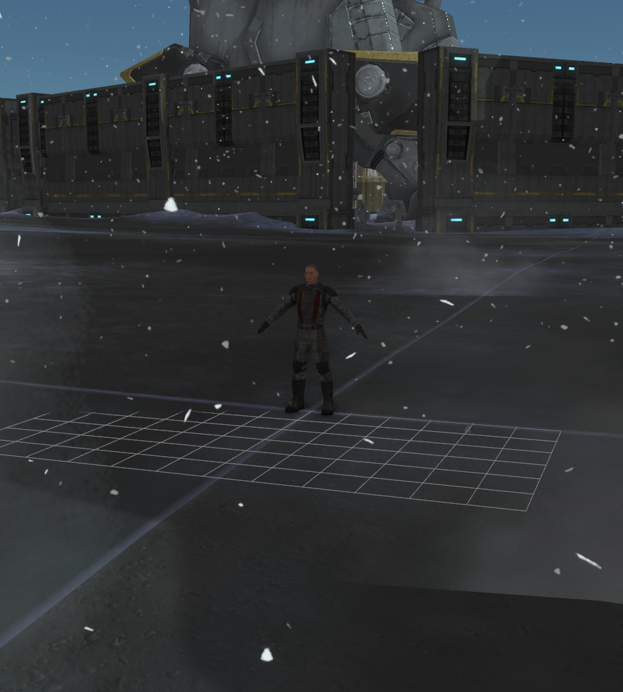

  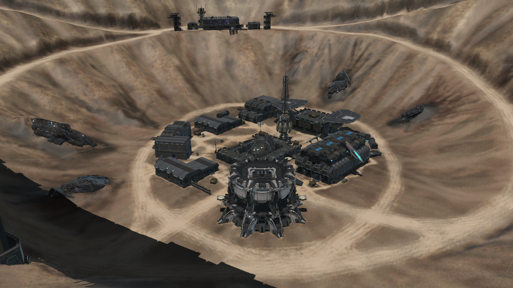 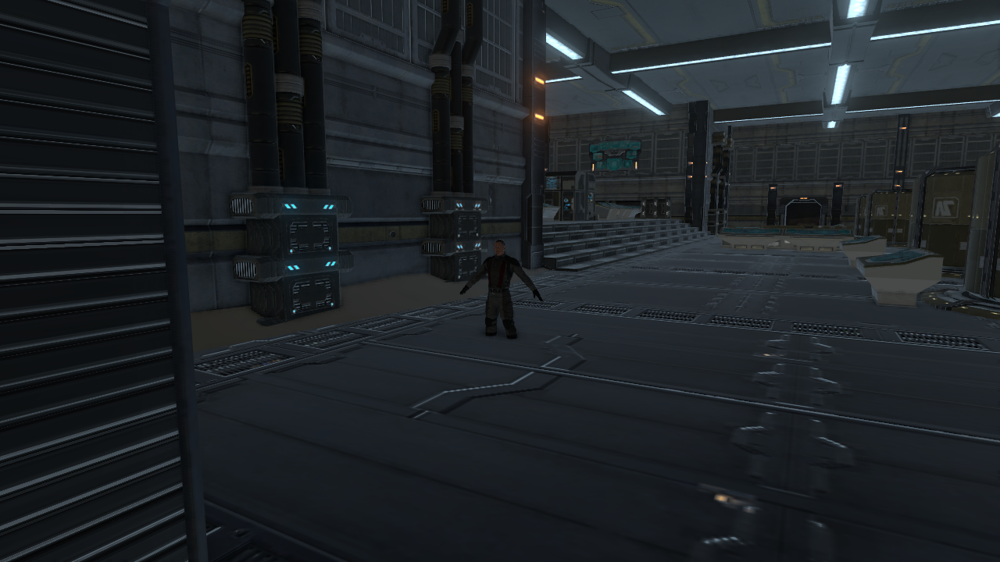
  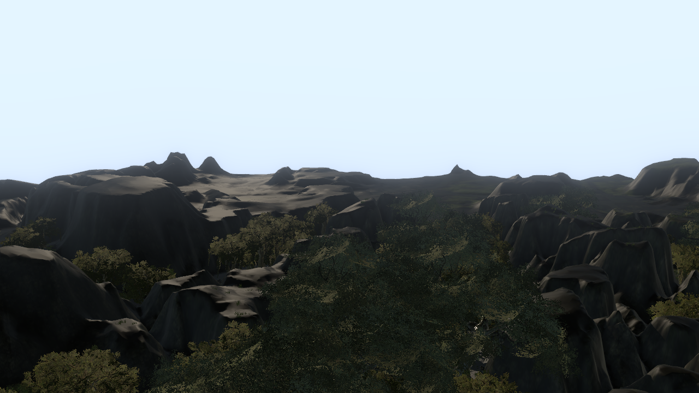 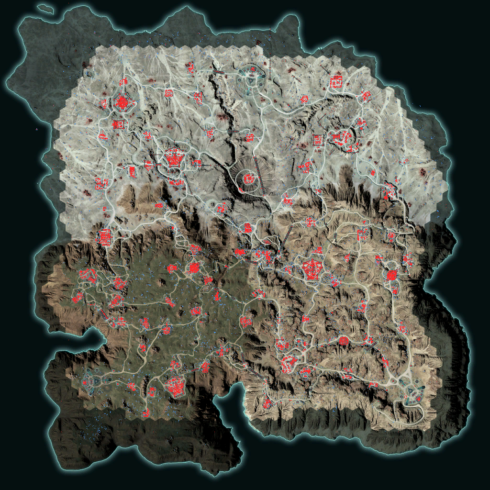
- **Poses** : copier, coller et coller en miroir (gauche ↔ droite).
- <a id="annuler-retablir"></a>**Annuler / rétablir**, et projets sauvegardés en `.psproj` (JSON) dans `Documents/PlanetStudio`.
- <a id="fenetre-exporter"></a>**Fenêtre Exporter** (bouton 🎬 Exporter de la vue, ou Fichier > Exporter), dans l'esprit
  d'Adobe Media Encoder : réglages à gauche, aperçu de la caméra de prise à droite (post-traitement
  compris), barre de temps et transport (début, image précédente, lecture / pause, image suivante,
  fin), résumé du fichier et bouton d'export en bas. Les réglages sont gardés d'une session à l'autre.
  - **Format de prise de vue** : la caméra de prise a son propre format (largeur × hauteur,
    enregistré dans le projet, 1920 × 1080 par défaut), réglé par le bouton `▭ 1920×1080` de la
    barre 🎥 Prise ou par la section « Caméra de prise » de la fenêtre Exporter : 720p, 1080p,
    1440p, 4K, ultra-large 21:9, cinéma 2,39:1, vertical 9:16, carré, portrait 4:5, photo 3:2, A4,
    ou personnalisé (proportions verrouillables). Il fixe le cadre de la vue « Prise » et les
    proportions de toutes les images ; vidéos et photos en sont un multiple (×0,5 à ×4, ou une
    largeur libre) : par exemple vidéo ×1 en 1080p et photo ×2 en 4K, avec le même cadrage.
  - **Onglet Vidéo** — formats : H.264 (MP4, jusqu'en 4K), AV1 (MP4, jusqu'en 8K), GIF animé,
    séquence d'images (PNG, JPEG, TIFF, WebP, BMP, TGA) ; taille : multiple du format de prise
    (×0,5, ×1, ×1,5, ×2, ×3, ×4) ou largeur libre ; images/s : celle
    du projet ou 10, 12, 15, 23,976, 24, 25, 29,97, 30, 50, 59,94, 60, 119,88, 120 (l'animation est
    rééchantillonnée, sa durée ne change pas) ; débit : CBR, VBR 1 passe, VBR 2 passes, CRF, avec
    débit cible et débit maximal (H.264) ; plage : timeline entière, entrée / sortie (repères posés
    sous l'aperçu, glissables, enregistrés dans le projet et visibles sur la timeline) ou
    personnalisée.
  - **Onglet Image** : l'image courante, en PNG, JPEG (qualité réglable), TIFF, WebP, BMP ou TGA ;
    nom du fichier, numérotation automatique pour ne pas écraser, taille en multiple du format de
    prise (×2 par défaut), post-traitement et qualité du rendu dans la fenêtre.
  - En Rust, sans ffmpeg : H.264 par OpenH264 (compilé depuis ses sources, profil High), AV1 par
    rav1e, multiplexage MP4 écrit à la main. Le VBR 2 passes met les images de côté dans un fichier
    temporaire à côté de la vidéo (effacé à la fin) : une passe d'analyse mesure la complexité de
    chaque seconde, la seconde passe y répartit le débit.

### Contrôles

Le menu **Aide** ouvre une fenêtre à trois onglets : *Prise en main* (six étapes, avec les
touches actuellement réglées), *Souris et caméras*, et *Raccourcis*, où chaque touche se change :
clic sur la touche, puis appui sur la nouvelle (Échap annule, clic droit efface). Chaque action
accepte deux touches ; une touche déjà prise est retirée de l'autre action. Les réglages sont
enregistrés dans `%APPDATA%/PlanetStudio/config.json`. Les touches de déplacement sont lues par
leur position sur le clavier (Z/Q/S/D en AZERTY = W/A/S/D en QWERTY).

La caméra se pilote comme un drone ou la caméra d'observateur d'un jeu : clic droit tenu pour
regarder, Z/Q/S/D pour voler dans la direction du regard. Le vol accélère et freine en douceur. Le
menu 🚁 en haut de la vue règle la vitesse, la sensibilité de la souris, l'inertie et l'inversion
verticale (enregistrées dans la configuration).

Touches par défaut :


| Action | Contrôle |
|---|---|
| Regarder autour (vol libre) | clic droit tenu (curseur caché) |
| Voler | Z/Q/S/D (W/A/S/D en QWERTY), A/E en tenant le clic droit ou Pg.Préc/Pg.Suiv pour descendre/monter, Maj = plus vite |
| Vitesse de vol | clic droit + molette, ou le menu 🚁 de la vue |
| Avancer / reculer d'un cran | molette |
| Orbite autour du point visé | Alt + clic gauche |
| Glisser la vue | clic milieu, ou Alt + Maj + clic |
| Lecture / pause | Espace |
| Image précédente / suivante | Flèche gauche / droite |
| Poser une clé | K |
| Gizmo rotation / translation | E / W |
| Cadrer la sélection | F |
| Caméra de travail / de prise | C |
| Photo par la caméra de prise | P |
| Annuler / rétablir | Ctrl+Z / Ctrl+Y (ou Ctrl+Maj+Z) |
| Supprimer l'acteur sélectionné | Suppr |
| Enregistrer | Ctrl+S |

## Outils en ligne de commande

`flcli` sert à explorer et extraire les assets :

```bash
cargo run --release -p flcli -- list .. prowler
cargo run --release -p flcli -- extract .. Armor_TR_Male ./extrait
cargo run --release -p flcli -- info .. Armor_TR_Male_HeavyAssault_Base.adr
cargo run --release -p flcli -- obj .. Armor_TR_Male_HeavyAssault_Base.adr soldat.obj
```

Le studio a aussi un mode de rendu sans fenêtre, utile pour les tests et les vignettes :

```bash
planet-studio --capture <dossier_jeu> sortie.png Armor_TR_Male_HeavyAssault_Base.adr Head_Male_Caucasian.adr --pose R_ELBOW=0,0,70 --yaw 30
```

Un modèle suivi de `@OS` est lié à cet os du premier modèle au lieu d'être fusionné (armes d'un MAX :
`Armor_TR_Male_Max_Look001.adr Weapon_TR_MaxAntiInfantryLeft001.adr@L_WEAPON`).
Pour un gros plan, `--zoom 4 --aim 0.35` rapproche la caméra et monte la visée de 35 cm.
`--light 1,-0.3,-0.35` change la direction de la lumière (utile pour juger le relief en lumière rasante).
`--no-shadows` coupe les ombres et `--ground-shadow 0.4` règle l'opacité de l'ombre au sol.
`--actors-lit` empêche le décor d'ombrer les personnages (ils gardent le soleil sous les arbres).
Qualité : `--quality apercu|equilibre|final`, `--msaa 1|2|4|8`, `--fxaa`, `--no-specular-aa`,
`--flora-quality basse|haute`, `--water-quality basse|haute`, `--terrain-quality basse|moyenne|haute|ultra`,
`--shadow-quality off|low|medium|high|ultra`, `--brightness 1.2`, `--supersample 2`, `--bloom 1.5`,
`--ao 0.8`, `--ao-radius 0.3`, `--no-bloom` et `--no-ao` (capture : « Équilibré » sans
suréchantillonnage par défaut), `--texture-sharpness 0.5` et `--no-bicubic`.
Post-traitement : `--look neutre|cinema|jeu`, `--exposure 0.5`, `--tonemap aucun|doux|aces|agx`,
`--contrast 1.1`, `--saturation 1.2`, `--temperature 0.3`, `--tint 0.5`, `--game-grading` (ou
`--no-game-grading`, étalonnage du jeu selon l'heure), `--vignette 0.3`, `--grain 0.2`,
`--sharpen 0.5`, `--dof auto` (ou une distance en mètres) et `--dof-blur 1.5`.
`--sun-preset coucher` (ou `studio`, `midi`, `matin`, `nuit`) choisit un soleil prédéfini ;
`--sun 70,20` (azimut, hauteur), `--sun-color 1,0.8,0.6` et `--sun-int 1.2` le règlent finement.
`--light` reste prioritaire pour donner une direction brute. `--sun-key 0:midi --sun-key 90:coucher`
anime le soleil (préréglage, ou `IMAGE:azimut,hauteur[,r,v,b[,intensité]]`) ; avec `--video`,
chaque image a son soleil, et une image fixe prend celui de `--time` ou `--bake-frame`.
`--amb-key 0:1 --amb-key 150:0.25` anime l'intensité d'ambiance (`IMAGE:intensité[,rotation[,r,v,b]]`,
les trois derniers nombres donnant le fond) ; `--background 0.02,0.02,0.05` fixe le fond.
`--ambiance esamir` (ou `studio`, `indar`, `indar-savane`, `amerish`, `nexus`, `dome`, `exterieur`) choisit l'ambiance, avec
`--ambiance-rot 90` et `--ambiance-int 1.5`. La variable `AMBIANCE_PNG=pano.png` enregistre le
panorama construit. `--camo defaut` (ou `aucun`, ou un nom de texture comme `Woodland_TC`) habille
tous les personnages, avec `--camo-scale 6` et `--camo-int 0.8`. `--decal defaut` (ou `aucune`,
ou un nom comme `Decal_AGONcyan_128`) pose une décalcomanie, avec `--decal-opacity 0.8`.
`--decor Indar:139,-2376,250` charge le décor d'une carte autour du point (x, z) du jeu, dans un
rayon de 250 m. `--no-flora` retire la végétation, `--no-terrain` le terrain, `--decor-ground 218.9`
impose la hauteur du sol
et `--decor-shadow 300` la zone ombrée. `--sky-hour 21` choisit le ciel de la carte (heure de 0 à
24) et `--no-sky` le retire. Sans option `--sun*`, le soleil et l'ambiance suivent aussi cette
heure. `--no-fog` retire le brouillard et `--fog-density 2` le double ; `--haze 0` retire le seul
voile de l'air (`--haze 2` le double), `--sun-glow 0` le halo du soleil. `--decor-lights 0` éteint
les lampes du décor (`--decor-lights 2` les double). `--no-sun-rays` retire les
rayons du soleil et `--sun-rays 2` les renforce.
`--particles neige` (ou `auto`, `aucune`, `feuilles`, `sable`, `papillons`) choisit les particules d'ambiance
(« auto » par défaut, selon le continent du décor), avec `--particles-density 2`, `--particles-size 1.5`,
`--wind 2` (force du vent) et `--wind-dir 90` (direction, en degrés ; 0 = +X). Elles sont prises à
l'instant de `--bake-frame` (ou `--time`), à 30 images/s. Sans asset, seul le décor est rendu. `--eye x,y,z`,
`--target x,y,z`, `--fov 40` et `--size 1280x720` imposent la caméra et la taille de l'image.

```bash
planet-studio --capture <dossier_jeu> crown.png --decor Indar:1098,64,300 --eye 150,90,150 --target 0,0,0
flcli carte <dossier_jeu> Indar indar.png     # vue d'ensemble, objets en points
flcli zone <dossier_jeu> Indar Biolab         # acteurs placés et nombre d'instances
flcli terrain <dossier_jeu> Indar 0 0         # chunks .cnk1 autour de (0, 0), contrôle du repère
flcli normales <dossier_jeu> Amerish 0 0      # convention des normales rangées dans les textures
flcli melange <dossier_jeu> Indar 0 0         # cartes de mélange des écosystèmes (PNG), vérifiées par la flore
flcli eco <dossier_jeu> Indar 15              # où pousse l’herbe verte (écosystème 15)
flcli zone <dossier_jeu> Indar @2342,-2079,8  # acteurs ayant une instance à moins de 8 m du point
flcli png <dossier_jeu> snow_strip.dds neige.png  # décode une texture en PNG
flcli versions <dossier_jeu> sky_amerish.xml copies   # chaque copie d'un asset dans les archives
flcli audit <dossier_jeu> Hossin              # acteurs, textures, effets et matériaux du décor
```

Animation FBX Mixamo transférée sur un soldat (ici l'image 110, à 30 i/s) :

```bash
planet-studio --capture <dossier_jeu> sortie.png Armor_TR_Male_HeavyAssault_Base.adr Head_Male_Caucasian.adr --anim Dancing.fbx --bake-frame 110
```

Contenu d'un FBX (hiérarchie, positions de repos et en milieu d'animation) :

```bash
cargo run --release -p flcli -- fbx Dancing.fbx
```

## Architecture

```
crates/forgelight   bibliothèque de lecture des formats du jeu
  pack.rs           archives .pack2 (index CRC64, zlib)
  namelist.rs       reconstruction des noms de fichiers (et noms devinés des acteurs non cités)
  dme.rs            modèles DMOD v4 et matériaux DMAT (taille d'index : le bit de poids fort est un drapeau)
  materials.rs      materials_3.xml (dispositions des sommets)
  model.rs          décodage des sommets, poids et os
  skeleton.rs       noms des os, hiérarchie, poses
  adr.rs            acteurs (.adr)
  morpheme.rs       réseaux Morpheme (.mrn) : squelette, tables, clips NSA
  fbx.rs            animations de squelette FBX binaires (exports Mixamo)
  dds.rs            textures BC1 à BC7 (couleur en sRGB, cartes _N et _S en linéaire)
  tga.rs            images TGA (dômes d'ambiance)
  zone.rs           cartes (.zone) : écosystèmes, objets et lumières placés, vue d'ensemble par tuiles
  terrain.rs        terrain (.cnk1 à .cnk5) : quarts, maillage monde, hauteur en un point
  lzham.rs          décompression LZHAM alpha (enveloppe zlib), en Rust pur
crates/flcli        outil en ligne de commande
crates/studio       l'éditeur (eframe/egui + wgpu)
  render.rs         rendu skinné hors écran, MSAA 1 à 8×
  environment.rs    ambiances : panoramas du jeu, harmoniques sphériques, reflets
  camo.rs           camouflages : catalogue des motifs, réglages par acteur
  decal.rs          décalcomanies : catalogue, réglages par acteur
  skins.rs          skins des soldats : armures et casques du jeu par faction, sexe et classe
  decor.rs          décor des cartes : sélection dans un rayon, chargement parallèle
  sky.rs            ciel des cartes : dôme, astres et nuages du jeu selon l'heure (sky_<carte>.xml)
  particles.rs      particules d'ambiance : effets par continent, réglages, textures
  wake.rs           sillage des personnages dans l'eau du décor (relu dans la timeline)
  app/decor_ui.rs   fenêtre de choix de la carte et du lieu
  scene.rs          acteurs, liens, historique, format projet
  anim.rs           pistes et interpolation
  clips.rs          application et mélange des clips du jeu
  retarget.rs       transfert d'une animation Mixamo sur le squelette des soldats
  dance.rs          danses générées par cinématique inverse (IK à deux os)
  video.rs          export MP4 : encodage H.264 (OpenH264) et AV1 (rav1e), débit, multiplexage ISO BMFF
  export.rs         fil d'écriture des exports : MP4 1 ou 2 passes, GIF animé, images et séquences
  app/export_ui.rs  fenêtre Exporter : onglets Vidéo / Image, aperçu, transport, repères d'entrée et de sortie
  quality.rs        qualité graphique : réglages, préréglages, application au rendu
  post.rs           post-traitement : occlusion ambiante, bloom, assemblage final
  app.rs            interface, gizmos, timeline
```

### Formats décodés

- **pack2** : en-tête `PAK\x01`, puis une table de 32 octets par asset. Les noms sont identifiés par
  un CRC-64 Jones (réfléchi, init et xorout à `!0`) appliqué au nom en MAJUSCULES. Les données
  compressées commencent par `A1B2C3D4`, suivi de la taille (big-endian) et d'un flux zlib.
- **Hachage Jenkins one-at-a-time en arithmétique signée** : il identifie les définitions de matériau
  (nom tel quel), ainsi que les textures et les os (nom en MAJUSCULES).
- **DME** : la disposition des sommets vient de `materials_3.xml`. Les indices d'os sont locaux à
  chaque draw call et sont traduits via la bone map. Les matrices de liaison inverses sont au format
  4x3 de D3D.
- **Squelette** : les `.dme` ne contiennent ni noms ni parents. Les noms sont retrouvés par un
  dictionnaire de noms hachés, et la hiérarchie par des règles sur le rig humain de PS2, avec un repli
  spatial pour les os inconnus.

- **Morpheme (.mrn)** : le fichier est un bundle d'entrées typées (1 = squelette avec noms, parents et
  pose de liaison ; 2 = table squelette → canaux sous forme de bitset ; 13 = noms des clips ;
  15 = clips). Les clips NSA contiennent deux sortes de canaux :
  - des canaux constants, quantifiés sur 3×16 bits ;
  - des canaux échantillonnés, stockés image par image : positions sur 11:11:10 bits, rotations sur
    3×16 bits sous forme de vecteurs « tangente du quart d'angle ».

  Les clips « Additive » contiennent des écarts purs. Ils se composent en base × écart dans le repère
  local de chaque os, ordre vérifié visuellement. Chaque canal a une moyenne (u8) et des jeux de
  quantification partagés. Un bloc
  « trajectoire » séparé donne le déplacement de la racine depuis le début du clip
  (positions sur 11:11:10 bits, rotations sur 3×16 bits). La pose de liaison du
  squelette Morpheme correspond à celle des `.dme` à 0,06° près.

- **FBX (Mixamo)** : FBX binaire 7.x (champs d'en-tête sur 64 bits à partir de 7500, tableaux
  zlib). On évalue chaque nœud `Model` comme le SDK FBX : T · Roff · Rp · Rpre · R · Rpost⁻¹ · Rp⁻¹
  · Soff · Sp · S · Sp⁻¹, avec les angles d'Euler dans l'ordre `RotationOrder`. Les pré-rotations ne
  comptent que si `RotationActive` vaut 1. Les courbes sont interpolées linéairement et
  rééchantillonnées à leur cadence, déduite des clés (en général 30 ou 60 i/s). La pose de repos
  vient des propriétés des nœuds (la T-pose chez Mixamo), ou de la `BindPose` si le fichier en a une.
- **Transfert Mixamo → soldat** : Mixamo est en T-pose et le soldat en A-pose, avec des axes locaux
  différents. Chaque os du soldat est d'abord tourné pour pointer comme son équivalent Mixamo au
  repos. Pour les mains et les doigts, la largeur de la main (index → auriculaire) fixe aussi la
  rotation sur l'axe de l'os. On applique ensuite, image par image, la rotation monde de l'os Mixamo
  par rapport à son repos, puis on repasse en rotations locales. Le repère du FBX est aligné sur
  celui du soldat d'après les hanches et le cou. Les longueurs d'os restent celles du soldat. Hips
  pilote le COG ; PELVIS, les os de torsion (`SHOULDERROLL`, `FOREARM`) et les armes suivent leur
  parent.
- **Textures de matériau** : le rôle des canaux a été déduit des images (le shader du jeu,
  `Character.efb`, n'est pas dans les archives lues) :
  - `_N` est au format DXT5nm : X dans A, Y dans G (R copie G, B est un masque). La convention est
    celle d'OpenGL (Y vers le haut de l'image), vérifiée par le rotationnel de la carte. Les
    sommets des personnages n'ont pas de normale mais une tangente (+u) et une binormale (−v) ;
    `flcli info` affiche cette orientation.
  - `_S` : R métal, G brillance (rugosité = 1 − G), B émissif, A occlusion des reflets. Le B est
    certain (il allume exactement les LED et emblèmes). G est une brillance et non une rugosité :
    il est plus fort sur l'œil (231) que sur la peau (189), faible sur les tissus TR (75), et
    très fort sur la combinaison VS, satinée en jeu (240). R et A restent une interprétation PBR
    cohérente à l'œil (lire R comme une simple intensité des reflets délave les casques peints).
  - Le relief de détail (`_DS` + cubemap de motifs) se répète sur UV1 autant de fois que le dit le
    paramètre flottant `-560293637` du matériau (`forgelight::slot::DETAIL_REPEAT`) : 40 sur les
    tenues et les véhicules, 6 sur un petit objet de décor. Sans lui, un seul motif couvre tout
    le corps et dessine de grandes taches.

- **Emplacements de texture** : chaque paramètre de texture du DMAT a un hash, identique au
  `semanticHash` des alias de texture des `.adr`. Sur les matériaux de personnage : couleur
  `-1295769314`, relief `789998085`, brillance `67211600`, choix du relief de détail (`_DS`)
  `1716414136`, motifs de détail `-125639093`, décalcomanie `-305773271`, camouflage
  `-1880953979` (constantes `forgelight::slot`). `flcli info` les affiche.
- **Jeux d'UV des personnages** : UV0 pour l'atlas partagé entre classes (`_C`, `_N`, `_S`,
  `_DS`), UV1 pour un dépliage complet du corps (le camouflage), UV2 pour la projection du
  décalcomanie (déborde de 0..1, centrée selon `DecalTintTranslations` de l'`.adr`).
- **Camouflage** : le masque est le canal B de `_N` (blanc sur la tenue, noir sur bottes, gants,
  ceinture, genouillères, emblèmes, et nul sur le visage). `_DS` n'est pas un masque de
  camouflage : son codage change d'une faction à l'autre ; il choisit sans doute le motif de
  relief de détail. Le jeu n'a pas de liste des camouflages (objets définis côté serveur) :
  le catalogue retient les textures nommées `*camo*` ou `*_TC`, hors décor et icônes. Le mélange
  exact du jeu est inconnu : PlanetStudio multiplie le motif par la luminosité de `_C`
  (rapportée à 0,2 en linéaire), ce qui garde plis et ombrage peints et assombrit le motif sur
  une tenue sombre. L'alpha des motifs (constant à 0,41 sur les camouflages par défaut) n'est pas
  utilisé.
- **Décalcomanie** : le carré 0..1 de UV2 tombe sur la face extérieure des épaulières (les
  deux côtés), et nulle part sur les casques. Tous les `.adr` lus la placent au centre
  (`xUvLocation` = `yUvLocation` = 0,5, échelle 1, rotation 0) : ce placement n'est donc pas lu.
  La texture se pose par son alpha. `white.dds`, qui occupe l'emplacement sur les armures VS et
  les casques, est un carré blanc opaque : il est traité comme « pas de décalcomanie ». Le
  catalogue retient les `Decal_*.dds`, sans les variantes 32 et 64 pixels des icônes.
- **Ombres** : carte de profondeur 4096×4096 rendue depuis le soleil en projection
  orthographique, recalculée à chaque image. Elle est cadrée sur les os des personnages (position
  courante = matrice de skinning × position de repos), avec 40 cm de marge pour l'épaisseur des
  corps. Le plan lointain va 200 m au-delà, pour que le sol reçoive l'ombre. Filtrage 3×3 pour
  des bords doux. Contre l'« acné » d'ombre : biais de profondeur à la passe d'ombre, et décalage
  de 1,5 texel le long de la normale géométrique tournée vers le soleil. Le sol est un carré de
  200 m à la hauteur de la grille (y = 0), dessiné en noir avec pour alpha l'ombre reçue.
  Avec un décor, une seconde couche de la carte (tableau de 2) reçoit le décor seul, cadrée sur
  sa zone large ; les personnages gardent leur couche cadrée serrée (ombre nette). Le décor
  multiplie sa couleur par `1 − opacité × (1 − ombre perso) × soleil non masqué par le décor`.
- **Cartes (`.zone`, version 1)** : `ZONE`, version, six offsets absolus (écosystèmes, flore, murs
  invisibles, objets, lumières, inconnu), puis la grille du terrain (tuiles de 64 m ; Indar,
  Amerish, Esamir et Hossin font 128 × 128 tuiles, soit 8 192 m de côté). La section objets donne,
  par acteur (`.adr`), sa distance d'affichage puis ses instances de 57 octets : position,
  rotation et échelle (4 × f32 chacune), identifiant (u32), « pas d'ombre » (u8) et
  multiplicateur de LOD (f32). La rotation est en radians, x = lacet (autour de Y), y = tangage,
  z = roulis, composée comme `D3DXMatrixRotationYawPitchRoll` (Ry · Rx · Rz) ; les bâtiments
  faits de plusieurs pièces s'assemblent bien ainsi. La lecture tombe exactement sur l'offset des
  lumières pour toutes les cartes. Les noms des cartes ne sont dans aucun autre fichier : ils sont
  essayés directement (Indar, Amerish, Esamir, Hossin, VR, Tutorial, quickload).
  La section lumières donne un nombre (u32), puis pour chacune : nom et nom de teinte (chaînes :
  `PointLight_…`, `White`, `WarmLight`, `Orange`, `blue_ampstationlegs`, `WarpGateBlue`…), type
  (u16 : 1 ponctuelle, 2 projecteur), 3 octets à 0, position et rotation (4 f32 chacune, rotation
  comme les objets ; un tangage positif pointe le projecteur vers le bas), portée (m) et un second
  nombre lu comme l'intensité (0,12 pour un voyant, 1 pour une lampe d'arche, 2,8 à 4 pour un
  grand projecteur), couleur (A, R, V, B), 5 octets, cône (4 f32 : angles entiers intérieur et
  extérieur en radians, exposant ; π/4, π/3, 1 par défaut sur les ponctuelles), une chaîne vide
  et un identifiant (u32). La lecture finit exactement sur l'offset suivant (7 166 lumières sur
  Amerish, 4 712 ponctuelles et 2 454 projecteurs).
  La section écosystèmes donne, pour chacun : numéro, nom, textures de détail `_cnx` (couleur,
  normale X dans l'alpha) et `_sbny` (normale Y dans l'alpha), répétitions par tuile de 64 m,
  force du mélange, spéculaire et lissé min/max, matériau physique (`grass`, `rockgrey`…), puis
  ses couches de flore (densité, échelles, pente, altitudes, nom, teintes). La lecture tombe
  exactement sur l'offset de la flore pour les quatre continents.
- **Vue d'ensemble** : `<carte>_Tile_<a>_<b>_LOD<n>.dds`, tuiles de couleur du terrain (256 px),
  LOD 0 = 256 m … LOD 3 = 2 048 m. `a` suit le z du monde et `b` le x ; dans une tuile, les
  colonnes suivent z et les lignes x croissant (la ligne 0 au x minimal). Ce repère a été vérifié
  en superposant les objets de la carte aux bâtiments peints sur les tuiles.
- **Textures des décors** : sur les matériaux `Structure`, la liste des textures contient aussi
  des textures de détail (`Shared_MetalSurface_*_C.dds`) ; la couleur, le relief et la brillance
  sont donc pris dans leur emplacement (mêmes hash que les personnages) avant de deviner par le
  nom. Les textures du décor sont limitées à 1 024 px (mips supérieurs ignorés).
- **Palettes imposées** (`PALETTE_OVERRIDES` dans `forgelight/src/lib.rs`) : PlanetStudio lit les
  matériaux intégrés au `.dme` et ignore le `paletteName` des `.adr`. Une table remplace les
  textures de certains matériaux par celles d'un `.dma`, en gardant leur définition (donc la
  disposition des sommets). Seul cas : les nervures du dôme du Biolab
  (`FacilityBioLab_Shield2_LOD0.dme`, matériau 0). Le jeu les habille d'Auraxium (`gold.dds`,
  shader `Auraxium.efb`), ce qui donne des bandes jaunes mates faute de ce shader. On reprend
  l'ancienne palette `Shield2_LOD0.dma`, en métal gris des bâtiments (`FacilityBuildings_C/N/S`).
  Sa coque n'est pas reprise : la texture intérieure y fait des taches turquoise.
- **Décors du Biolab** (`forgelight/src/lib.rs`, `load_dme`) : plusieurs modèles ont gardé des
  textures enneigées d'Esamir (variante d'alias « Default1 », sans doute un reste d'Auraxmas :
  il existe un `MutatedTrees_01_AURAXIMAS_Lod0.dma`). Hors d'Esamir, une couleur `Esamir_*` dont
  le relief appartient à une autre famille est remplacée par la couleur assortie au relief
  (`FacilityBioLab_Dirt_C`, `MutatedTrees_Bark_C`), et une texture `Esamir_*` qui a une
  variante `_NoSnow` prend celle-ci (lierre). Les feuilles des grands arbres
  (`Flora_TallTree_01`) n'ont pas de couleur propre : la forme est le canal B de
  `TallTree_Leaves_S` et la couleur vient des teintes du `.adr` (violet, jaune). Le studio compose
  donc `TallTree_Leaves_C.dds` (`MASKED_FOLIAGE`) ; les nuances sont une approximation. Les
  maillages `Invisible` ou `OcclusionModel` (volumes de collision, qui faisaient des plaques
  grises sous les arbres mutants) et `Designer` sans texture ou peints de la couleur de
  remplissage `medium_slate_blue.dds` (occluders des bâtiments de cour
  `Common_Structures_CourtyardBuilding_A_Occluder*`, qui bouchaient les fenêtres d'un panneau
  lavande) ne sont pas dessinés.
- **Ciel (`sky_<carte>.xml`)** : absent de la namelist, retrouvé par son nom. La section `<Dome>`
  liste par heure la texture du dôme (`sky_Indar_Dome_1200.tga`…, 128 × 256, équirectangulaire :
  zénith en haut, horizon au milieu). Hossin et VR reprennent les dômes d'Indar ;
  Esamir a les siens. Sans fichier (quickload), le ciel d'Indar sert de repli.
  **Amerish** : la table des terrains (`ObjectTerrainData`) cite `sky_amerish.xml`, un ancien
  ciel (dômes d'Indar, brouillard gris-blanc dense, étalonnage neutre) qui délavait tout le
  décor. Le jeu live affiche en fait un ciel de `data_x64_0.pack2` au nom inconnu (hash
  `0x3490E7B6CF249CF5`, identique à `sky_searhus.xml`) : dômes `sky_amerish_dome_*`, lune et
  étoiles de `amerish_starfield.xml`, tables `amerish_colorkey_*` (sarcelle la nuit, rouge
  écrasé), pas de brouillard le jour et un voile léger (1 575 m, 0,25). Les captures de nuit
  du jeu (grosse lune bleutée à cratères, ombres sarcelle) n'existent qu'avec lui ; le studio le
  charge pour Amerish. Son cycle est décalé de 12 h (lune haute à 12 h du fichier, soleil à
  0 h) : l'heure du studio y est avancée de 12 h, si bien que 13 h reste le plein jour.
  Sa nuit est calée sur des captures du jeu live : le sol éclairé par la lune y correspondait,
  mais le ciel sortait bien plus clair. Dans le jeu, le haut du ciel n'est que le noir relevé en
  sarcelle par `amerish_colorkey_night` : le dôme, son horizon (brouillard, voile), les nuages et
  l'air éclairé (rayons) sont donc ramenés à ×0,1 en pleine nuit, les astres (lune, étoiles) à
  ×0,4, en proportion de la force de la lune (×1 au soleil de midi). Le bas du dôme n'est
  ramené qu'à ×0,5 (dégradé jusqu'à 37° de hauteur, brouillard lointain compris) : la lueur
  sarcelle au-dessus des crêtes, plus claire que le zénith, comme dans le jeu. Avant/après, ciel
  (20, 84, 130) → (3, 42, 76) pour (0, 35, 67) dans le jeu, lune (73, 188, 221) →
  (55, 170, 206) pour (70, 161, 194). La texture du disque (`esamir_planets.dds`) est presque
  unie (211 à 222 en sRGB) alors que la lune du jeu montre des cratères bien marqués : son
  contraste est accentué (exposant 6 autour de la valeur médiane), ce qui donne l'écart des
  captures entre taches et fond (vert de 149 à 190, 136 à 185 dans le jeu).
  Les fonds d'étoiles sont toujours dessinés derrière les autres astres (Amerish et Nexus leur
  donnent `Depth` −2, ce qui les aurait mis devant la lune), et la nuit le disque de la lune cache
  le ciel derrière lui comme les planètes.
  `<SunLight>` donne la lumière par heure (`Direction` : `Heading`, `Pitch` ; `Color` : RVB et
  `Brightness`, environ 12 à 14 en plein jour, 2 à 5 la nuit). `<Fog>` donne la couleur, la
  densité par mètre qui décroît au-dessus d'un plancher (`Distribution` : `Density`, `Gradient`,
  `Floor`), le début (`Range` ; le studio l'adoucit : le brouillard monte dès la caméra et
  rejoint « distance − début » à deux fois cette distance, sinon un bâtiment juste en deçà
  reste net devant un relief voilé juste au-delà) et la distance où tout se fond dans le ciel (`FadeRange`). Les
  valeurs sont interpolées entre les heures (le cap par le plus court chemin).
  `<Post>` contient aussi le voile de l'air, `<Haze Distance="1075" Strength="0.5"/>` (Indar,
  Hossin, Oshur, VR ; 1 575 m et 0,25 sur Amerish ; 775 m et 1,5 sur Esamir et Nexus ; distance nulle sur Koltyr,
  sans voile). Le studio voile le décor vers l'horizon du dôme dans la direction du regard, de
  `1 − exp(−force × (1 − exp(−distance / Distance)))`, et le ciel de `1 − exp(−force)` (39 % sur
  Indar) : c'est ce qui donne le ciel pâle, aux nuages discrets, et les reliefs lointains
  délavés des captures du jeu (le dôme `sky_Indar_Dome_1200.tga` seul est d'un bleu saturé).
  La même section donne l'exposition et l'étalonnage, que le studio applique avec « Étalonnage
  du jeu » (post-traitement) :
  - `<Exposure WhitePoint>` : 11,3 en plein jour sur Indar, 4,8 à l'aube et au coucher, 4,5 la
    nuit. Le studio en fait le point blanc d'un Reinhard étendu, `x (1 + x / W²) / (1 + x)` :
    les tons moyens ne bougent pas, mais un point blanc bas rend les hautes lumières plus
    claires (ciel du coucher lumineux au-dessus d'un sol sombre). C'est notre lecture de ce
    nom ; les captures du jeu lui donnent raison.
  - `<ColorGrading>` : tables `colorkey` par heure (RGB, 256 × 16 : x = tranche de bleu × 16 +
    rouge, y = vert), mêlées entre deux clés. Sur Indar, `colorkey_mildcontrast.tga` de 8 h à
    19 h 30 (courbe en S légère : −0,04 dans les ombres, +0,02 dans les lumières) et
    `colorkey_identity.tga` la nuit ; Amerish, Esamir, Hossin et Nexus ont leurs tables
    d'aube, de midi, de coucher et de nuit. Lues en trilinéaire sur l'image encodée sRGB.

  Le bloom, l'occlusion et les reflets de l'objectif (`<Lens>`) de cette section ne sont pas lus.
  La saleté de l'objectif de `<Lens>` (`DirtLayer1`, `DirtLayer2`, `DirtNoise` : disques flous
  et granuleux, éclairés par le bloom) est reproduite par le réglage « Saleté de l'objectif »
  du post-traitement, avec les valeurs d'Indar (les mêmes sur tous les continents, à l'intensité
  près), sans lire le fichier.
  `<Dome>` donne aussi, par clé, une correction d'exposition du dôme (`EvComp`) : −2 IL à 7 h,
  +1,2 IL à 13 h, +2 IL à 21 h sur Indar. Le studio l'interpole entre les clés et l'applique au
  dôme, à son horizon (brouillard, voile) et à ses reflets, relativement à 0,9 IL (ciel de midi
  ×1,23, du coucher ×2,1) : sans elle, le ciel du coucher (`sky_Indar_Dome_1600.tga`) restait
  violet sombre. Esamir et Nexus ont une autre échelle (5,5 et 4,3 IL à 13 h, pour des dômes
  pas plus sombres que celui d'Indar) : prise telle quelle, elle rendait le ciel d'Esamir 24 fois
  plus lumineux et noyait le décor dans un brouillard blanc. Le studio décale l'échelle de ces
  cartes pour que leur `EvComp` de 13 h vaille celui d'Indar (1,2), en gardant les écarts entre
  heures. Le jeu fond sans doute les dômes l'un dans l'autre ; le studio passe d'un dôme
  au suivant à l'heure de la clé (à 20 h 45 sur Indar, encore le dôme bleu de midi).
  `<Includes>` cite deux fichiers partagés entre cartes (Hossin, Oshur, le tutoriel et la VR
  reprennent les étoiles d'Indar ; Amerish, Esamir, Koltyr et Nexus ont les leurs) :
  - `<carte>_starfield.xml`, `<Satellites>` : chaque astre est un carré texturé (case `UVs` d'un
    atlas comme `esamir_planets.dds`) dans la direction `Orientation` (`Yaw` = cap, `Pitch` =
    hauteur, même repère que le soleil), de largeur `Size` en tangente de l'angle (0,075 pour le
    soleil, 0,65 à 0,85 pour la grosse planète), teinté par `Color` × `Brightness` (ramenée à 12
    = couleur telle quelle). `<Sun/>` marque le soleil ; `Depth` donne l'ordre de dessin. Les
    fonds d'étoiles (`indar_starfield01.dds`, `Size` 3, texture répétée 8 fois) sont ajoutés au
    ciel, avec une luminosité au carré pour qu'ils s'éteignent le jour (le jeu les noie dans
    l'exposition du ciel clair, que le studio ne reproduit pas). Les planètes aussi s'ajoutent
    au ciel : la lumière de l'atmosphère est devant elles, si bien qu'en plein jour elles sont
    pâles et jamais plus sombres que le ciel (la grosse planète d'Indar, basse sur l'horizon toute
    la journée, faisait sinon un dôme noir). Elles ne cachent le fond qu'à la tombée de la nuit,
    d'autant plus que le soleil est faible ;
  - `<carte>_Clouds.xml`, `<Clouds>` : `DensityTexture` (`sky_<carte>_clouds.dds`) contient trois
    formes de cumulus (R, G, B) et un voile de stratus (A), mêlés par `TextureDensityWeights`, avec
    `CumulusContrast` (exposant), `CumulusTiling` et `StratusTiling` (répétitions),
    `CumulusScroll` (défilement) et `Color`. Le studio projette la texture sur un plafond plat,
    la lit en bicubique (sinon le contraste fait ressortir la grille de ses pixels, très
    agrandis), et éclaire les nuages par le soleil courant. `SilverLining` et les réglages
    d'animation interne (`CumulusAnimation*`) ne sont pas repris.
- **Terrain (`<carte>_<a>_<b>.cnk<n>`)** : en-tête `CNK<n>`, version, taille décompressée,
  taille compressée, puis un flux compressé. Ce flux est du **LZHAM alpha 8** (2012) dans une
  enveloppe zlib : `5E D1` = méthode 14 (LZHAM), fenêtre de 2^20 octets, somme de contrôle %31
  juste. La version 1.0 de LZHAM (2015) n'est pas compatible. Viennent ensuite 2 bits de
  configuration (`00` : codes de Huffman, mise à jour normale des tables), puis les blocs.
  `lzham.rs` traduit le décodeur de référence (codeur arithmétique binaire sur 11 bits, codes
  préfixes quasi adaptatifs, 64 tables de littéraux selon les deux octets précédents) ; la somme
  Adler-32 finale est vérifiée. Un chunk de 3 Mo se décompresse en 20 ms environ.

  Une fois décompressé (niveaux 1 à 5), le chunk contient :
  - 4 textures, une par quart : couleur (`ColorNX`, DDS 512 px, normale X du monde dans l'alpha),
    spéculaire (`SpecNY`, normale Z du monde dans l'alpha ; `flcli normales` : cos moyen 0,96 à
    0,99 avec les normales du maillage) et 4 petits blocs : les numéros des écosystèmes présents
    sur chaque tuile de 64 m du quart. Faute de carte de mélange (voir `.cnk0`), le studio y prend, par quart, l'écosystème de sol et celui
    de roche les plus présents (les premiers de chaque liste comptent davantage) ;
  - une grille de hauteurs (4 × 65 × 65) ;
  - des indices (u16), des sommets de 12 octets (x, y de 0 à 64 dans le quart, hauteur lointaine
    et proche en 1/32 m, couleur) et un lot de rendu par quart.

  Un chunk de niveau n couvre 4 · 2^(n-1) tuiles de 64 m, avec un sommet tous les 2^n m. Le
  repère a été trouvé en essayant toutes les combinaisons (axes, ordre des quarts, sens) et en
  gardant celle où arbustes et rochers tombent sur le sol (`flcli terrain` : écart médian de
  0,9 m sur Indar, 1,25 m sur Hossin, contre 2,7 m et plus pour les autres combinaisons).
  - Dans le nom, `a` suit le z du monde et `b` le x.
  - Le quart 0 est au coin minimal, le 1 vers +z, le 2 vers +x, le 3 vers +x +z.
  - Dans un quart, x et y des sommets suivent x et z du monde.

  Le studio découpe le terrain en cellules de 512 m. Chaque cellule vient entièrement du `.cnk1`
  (dans le rayon) ou du `.cnk3` (au-delà), sans recouvrement. Le `.cnk0` sert à la flore du
  sol (voir plus bas).
  Pour que les quarts de 128 m ne se voient pas :
  - chaque quart a sa propre texture, lue sans boucler (`ClampToEdge`) : en répétition, le
    filtrage mêlait le bord opposé de la texture et traçait une fine ligne sombre sur chaque bord ;
  - une jupe verticale (12 m sous les quarts proches, 40 m sous les lointains) pend sous les
    arêtes de bord : le terrain proche (un sommet tous les 2 m) et le lointain (8 m) ne tombent
    pas l'un sur l'autre, et le ciel passait par les fissures ;
  - les normales des sommets communs à deux quarts sont moyennées ;
  - le détail des écosystèmes s'estompe près des bords dont le voisin a un autre détail.
- **Flore du sol (`<carte>_<a>_<b>.cnk0`)** : même enveloppe que les autres chunks (`CNK0`,
  LZHAM alpha), 4 × 4 tuiles de 64 m. Les plantes y sont déjà placées par le jeu (34,6 millions
  sur Hossin, 55 millions sur Amerish). Contenu décompressé :
  - 16 tuiles : rang x, y (absolus, en tuiles : x suit le z du monde, y le x), deux u32, puis
    leurs écosystèmes (numéro, puis une liste de plantes par couche de flore de l'écosystème),
    un index, une image DDS (mélange des écosystèmes, voir plus bas) et un dernier bloc (la liste
    des écosystèmes, dans un autre ordre, non utilisée) ;
  - un maillage fin du terrain : sommets par côté, grille de hauteurs (4 octets par point),
    indices (u16), sommets de 16 octets (x, z de 0 à 64 dans la tuile, hauteur lointaine et
    proche en 1/32 m, 8 octets) et un lot de rendu par tuile (jusqu'à 5 120 triangles).
  - Une plante = position compactée (u32) + teinte (octets B, V, R, A, comme une couleur
    Direct3D). Bits 0 à 13 : le triangle de la tuile ; bits 14 à 22 et 23 à 31 : coordonnées
    barycentriques sur 512 (leurs histogrammes décroissent en ligne droite et sont corrélés à
    −0,5 : u + v ≤ 1). `flcli flore` vérifie le repère contre le `.cnk1` : écart médian 0,00 m
    sur Hossin (3,3 m à 90 % avec les axes échangés) ; les nénuphars, limités à 0 à 4 m
    d'altitude, y tombent tous sauf 14 sur 1,76 million.
  - Le `.zone` donne, par écosystème, ses couches (densité, échelle min/max, pente, altitude,
    alpha min, nom de la plante, teintes) et, dans sa section flore, le modèle (`.dme`) et la
    texture de chaque plante. Le jeu tire le cap et l'échelle de chaque plante ; le studio les
    tire de sa valeur compactée (stable d'un chargement à l'autre), dans les bornes de la couche.
  - **Carte de mélange** d'une tuile : DXT5 (DXT1 quand la tuile a quatre écosystèmes ou moins),
    64 px pour 64 m. L'écosystème 0 de la liste de la tuile fait le fond ; R, V, B, A sont la
    présence des écosystèmes 1 à 4, peints l'un sur l'autre dans cet ordre (canaux sans
    écosystème à 0 ; l'alpha d'une DXT1 vaut 255). Les lignes suivent le x du monde, les colonnes
    le z. Vérifié avec la flore (`flcli melange`) : sous les plantes d'un écosystème, son canal
    vaut environ 230 sur 255 et les autres restent bas (herbe verte : A ≈ 150 ; roche : B ≈ 200).
    Le studio assemble les quatre tuiles d'un quart de 128 m en une carte de 128 px, lue sans
    déborder d'une tuile sur l'autre (les canaux n'y désignent pas les mêmes écosystèmes), et
    range les détails de tous les écosystèmes employés dans deux tableaux de textures (couleur
    rapportée à sa moyenne et hauteur de mélange ; relief).
  - Matériau `FloraModel` : couleur (atlas) multipliée par la teinte de la plante là où le masque
    `_TM` est blanc. La teinte passe au GPU dans la ligne w (inutilisée) de la matrice de
    l'instance.
- **Anticrénelage** :
  - MSAA : les échantillons sont résolus par le post-traitement, en moyenne pondérée par
    1 / (1 + luminosité). Une moyenne simple en HDR, écrêtée ensuite à 1, gardait un bord
    crénelé partout où un côté dépasse 1 (ciel clair, émissifs, reflet du soleil). 2× et 8× ne
    sont proposés que si la carte les accepte pour `Rgba16Float` et `Depth32Float` (fonction
    `TEXTURE_ADAPTER_SPECIFIC_FORMAT_FEATURES` demandée à la création de l'appareil) ;
  - feuillages : « alpha to coverage » sur les pipelines opaques. L'alpha est aiguisé sur un
    pixel (`(a − 0,5) / fwidth(a) + 0,5`), donc la découpe reste nette de près mais ses bords
    sont répartis sur les échantillons MSAA. L'alpha est aussi renforcé de 10 % par niveau de mip
    (4 au plus) : les mips moyennent l'alpha, et un arbre lointain se dégarnissait. Plus fort,
    le renfort fait ressortir les bords colorés (souvent cyan) des textures de feuillage ;
  - reflets : la variance de la normale entre pixels voisins (`dpdx`, `dpdy`) élargit la
    rugosité (Kaplanyan et Tokuyoshi, noyau borné à 0,18) ;
  - FXAA : version compacte de celui de Timothy Lottes, sur l'image finale (copie intermédiaire
    sRGB), en luminosité perceptive ; les zones peu contrastées ne sont pas touchées.
- **Eau (qualité haute)** : six vagues directionnelles de 0,9 à 9 m de longueur d'onde, animées
  par le temps de la timeline. Chacune s'efface quand sa longueur d'onde n'est plus que de
  quelques pixels au sol (sinon, moiré au loin). Le reflet vient du dôme du ciel de la carte
  (le panorama d'ambiance, 256×128, est trop flou), avec la part de Fresnel de l'ambiance ; un
  rayon renvoyé vers le bas par une vague est ramené juste au-dessus de l'horizon.
- **Eau des marais (`SwampWater`, effet `Water2013.efb`, technique `Swamp`)** : le shader du
  jeu n'est pas dans les archives. Les noms des paramètres du matériau ont été retrouvés par
  leur hash Jenkins (constantes `forgelight::slot::WATER_*`) : `BumpMap1` (rides),
  `BumpMap2` (tourbillons), `Foam` et `FoamNormal` (bulles), `Overlay` (algues), `Tint`
  (0,18 / 0,18 / 0 : olive sans bleu), `WaterTiling` (0,8), `FoamDepthBias` (0,14). D'autres
  (90, 14,185, 0,008…) restent anonymes. Le maillage `Hossin_Props_Water_LOD0.dme` est un plan
  de 1 024 m posé 122 fois sur la carte, à des hauteurs différentes. Dans `Algae_OC`, RGB est la
  couleur des algues et A l'eau libre (blanc) ou couverte (gris, 73) ; les deux sont corrélés à
  −0,92. Les reliefs sont en DXT5nm (X dans A, Y dans G) sans le suffixe `_N` : ils sont lus en
  linéaire. Le studio répète les textures en mètres (algues 9 m, bulles 2,5 m, rides 3,1 et
  4,7 m, tourbillons 7,3 m, calés à l'œil sur des captures du jeu), teinte les algues par
  `Tint` à mi-force (×2,2 en linéaire : vers sRGB 112 / 119 / 60 au soleil de midi, comme en
  jeu), leur donne une rugosité de 0,6 et le relief des bulles, et laisse à l'eau libre les
  rides, les tourbillons et 60 % du reflet (eau trouble). Les ronds sont procéduraux : une case
  de 4 m sur deux fait naître un rond toutes les 3,5 à 8,5 s en un point tiré au hasard ; il
  s'élargit à 0,7 m/s (crêtes de 0,2 m) et s'éteint en 3 s. Les effets placés par le jeu
  (`Hossion_Water_Ripple`, `_Bubbles`, `_Flies`, `_Fishswarm`, 15 en tout) ne sont pas lus. La
  transparence (fond vaseux visible) n'est pas reproduite.
- **Sillage dans l'eau** (`wake.rs`) : pour chaque personnage (acteur racine qui a des os
  `L_ANKLE` et `R_ANKLE`, 6 au plus), la position des chevilles est relue dans ses pistes aux
  instants passés, sans toucher à la pose courante (seules les chaînes d'os jusqu'aux
  chevilles sont évaluées). La hauteur de l'eau vient des instances des maillages d'eau du
  décor (point ramené dans le repère de l'instance, testé contre la boîte du modèle). Le shader
  reçoit, dans les globales, la traînée (30 points : tous les 0,125 s sur 2 s, puis tous les
  0,75 s jusqu'à 12 s) et 8 ronds émis tous les 0,35 s à des instants fixes de la timeline (sans
  cela, un rond garderait la même taille d'une image à l'autre), avec leur force selon la
  vitesse du personnage à cet instant. Chaque morceau de traînée donne l'eau brassée (largeur
  0,45 + 0,35 × âge m, décroissance exp(−âge / 1,6), réduite à 20 % à l'arrêt) et le chenal des
  algues (exp(−âge / 9)) ; un bruit de valeur animé fait les plaques d'écume, leur grain et les
  remous. Les ronds s'élargissent à 1 m/s (crêtes de 0,25 m). Un personnage est mouillé à moins
  de 1 m du milieu de ses chevilles, jusqu'à 8 cm au-dessus de l'eau, et jusqu'à 40 cm en
  courant.
- **Photos par tuiles** : au-delà de 4096 pixels de côté (image suréchantillonnée), l'image est
  découpée en tuiles d'au plus 4096 pixels, marges comprises. Chaque tuile est rendue avec une
  projection décentrée (une matrice d'échelle et de translation en coordonnées normalisées,
  composée avant la projection de la caméra) et une marge de 256 pixels tout autour, pour que
  l'occlusion, le bloom et la profondeur de champ voient leurs voisins. Seul le cœur est gardé,
  réduit puis recopié à sa place. Le cœur est un multiple du suréchantillonnage ; le vignettage
  et le grain sont calculés dans le repère de l'image entière. Les ombres sont cadrées sur les
  personnages, pas sur la caméra : elles ne changent pas d'une tuile à l'autre. La netteté d'un
  export suréchantillonné est appliquée après la réduction, sur le processeur (même calcul que
  le shader).
- **Étalonnage** (à l'assemblage) : exposition et balance des blancs en lumière linéaire (la
  balance garde la luminosité), rendu des tons, contraste autour du gris moyen (0,18) puis
  saturation, vignettage, grain. Le « filmique doux » est l'identité jusqu'à 0,6, puis une
  approche exponentielle du blanc à dérivée continue. ACES (approximation de Narkowicz) divise
  par 4 à 5 les tons très sombres : une scène de nuit demande alors +0,5 à +1 IL. Netteté :
  d'après AMD FidelityFX CAS, sur les 4 voisins, atténuée là où le contraste est déjà fort.
- **Profondeur de champ** : rayon du cercle de confusion = flou × |1 − mise au point / distance|
  (lentille mince), borné à 1,5 fois le flou de l'infini. Chaque pixel moyenne 48 points d'une
  spirale tournée au hasard dans son propre cercle ; un point dont le cercle n'atteint pas le
  pixel n'y participe pas (un personnage net ne bave pas sur le fond). Le cercle d'un pixel est le plus net de ses
  échantillons MSAA : le contour d'un personnage net garde son anticrénelage. Les points sont lus
  entre les pixels (bilinéaire), puis chaque pixel flou est moyenné avec ses voisins aussi flous,
  sur un demi-écart entre points (16 lectures) : plus de grain en damier sur les petites lumières
  du fond, et un voisin net n'y entre pas. Limite : un premier plan
  flou ne déborde pas sur un sujet net derrière lui. L'occlusion est appliquée avant le flou.
- **Post-traitement** : la scène est dessinée en HDR (`Rgba16Float`), puis :
  - occlusion ambiante à demi-résolution à partir de la seule profondeur (relue dans la cible
    multiéchantillonnée) : normale reconstruite à partir des voisins, 12 points dans un
    hémisphère tourné au hasard par pixel, puis lissage de 4 lectures filtrées à l'assemblage ;
  - bloom : extraction au-dessus d'un seuil de 1 (avec un genou progressif), 6 réductions
    (filtre « dual Kawase »), remontée en additionnant les niveaux ;
  - profondeur de champ (au choix) ;
  - assemblage : couleur × occlusion + bloom, étalonnage, vers l'image finale sRGB (l'occlusion
    s'efface sur ce qui dépasse 1 à 2,5 : néons, LED, reflets vifs) ;
  - FXAA puis netteté (au choix).

  Sans effets, l'image est la même qu'avant, à l'anticrénelage près sur quelques bords, désormais
  moyennés en lumière linéaire. L'occlusion s'applique à toute la lumière, soleil compris (un
  choix courant en temps réel, plus simple que de l'isoler sur l'ambiance), et la grille et les
  gizmos sont dessinés avant elle.
- **Particules d'ambiance** : sans état ni calcul sur le processeur. Chaque particule est un
  carré instancié dont le shader déduit tout de son numéro et du temps : elle naît en un point
  tiré au hasard, vit quelques secondes (fondus d'entrée et de sortie), puis renaît ailleurs.
  Elle reste dans une boîte qui suit la caméra (position ramenée modulo la boîte), posée sur le
  sol pour le sable et la neige soufflée. Une particule plus petite que 0,7 pixel est grossie
  avec une opacité réduite d'autant, pour ne pas scintiller. Les grains de sable sont étirés
  sur le chemin parcouru en 1/30 s (flou de mouvement). Les pixels transparents des textures du
  jeu (souvent noirs) prennent la couleur moyenne de la forme avant le calcul des mips, sinon
  les particules lointaines auraient un liseré sombre.
- **Panoramas d'ambiance** : `<continent>_ambient_c.dds` (256×128, équirectangulaire) contient
  le terrain lointain ; son alpha masque le ciel, laissé noir. `<continent>_ambient_n.dds` donne
  les normales du terrain (RGB) et sa distance (A) ; il n'est pas utilisé. Le jeu ne fournit pas
  de ciel par continent : PlanetStudio reprend celui de `ambient_blue_dome.tga`, teinté près de
  l'horizon par la couleur des reliefs lointains. Le panorama est réduit à 9 harmoniques
  sphériques pour le diffus, et ses mips servent aux reflets selon la rugosité. Toutes les
  ambiances partagent une même exposition, calée sur le dôme : la neige d'Esamir éclaire plus
  que la forêt d'Amerish. Les `Sky_<continent>_colorkey_*.tga` sont des tables d'étalonnage
  des couleurs (16 tranches de 16×16), pas des ciels.

## Limites actuelles et pistes

- Skins : `Helmet_NC_Male_All_Look013` figure dans la liste mais son maillage
  (`_LOD0.dme`) n'existe pas dans les archives ; le choisir affiche une erreur. Les matériaux
  Auraxium (`AuraxiumCharacter`) sont rendus comme une armure ordinaire, sans reflet doré.
  Dans l'inspecteur, seule la première pièce d'armure et le premier casque fusionnés sur le
  corps sont remplacés (un soldat monté à la main avec deux armures garde la seconde).
- Le rendu reste simplifié : un seul soleil (pas de lampes ponctuelles), plus l'ambiance. Le fond
  est une couleur unie (pas de ciel en dégradé) et la grille garde sa couleur la nuit. L'ombre au sol suppose un sol plat à y = 0 ; l'ambiance n'est pas occultée (pas d'occlusion
  ambiante). Restent à faire le relief de détail répété (`Shared_Characters_*`, choisi par
  `_DS`) et l'affichage du
  panorama en fond (il ne fait que 256×128 pixels, trop flou pour un décor).
- Les camouflages ne s'appliquent qu'aux matériaux de personnage qui ont un emplacement de
  camouflage et une carte de relief ; les véhicules ne sont pas couverts. Un changement de
  camouflage ou de décalcomanie ne passe pas par Annuler / rétablir. La décalcomanie ne se
  déplace pas (pas de réglage de position, d'échelle ou de rotation).
- Terrain : le mélange des écosystèmes suit la carte du jeu (1 m par pixel), mais le shader du jeu
  n'est pas lu : la façon de mêler les couches (l'une sur l'autre, hauteur de mélange) et la force
  du détail sont estimées. Sans `.cnk0`, le studio revient à un détail de sol et un de roche par
  quart de 128 m, estompé sur 16 m au bord des quarts voisins qui en ont un autre.
- Pas encore lus : les niveaux de détail des objets (toujours le modèle de base) et la plupart des
  effets attachés aux objets (`EffectList` des `.adr`, `.xml` de particules) : faisceaux des
  ascenseurs gravitationnels et des tubes d'apparition, sauteurs, dépôts de munitions, sauterelles
  lumineuses d'Hossin, spores d'Amerish, fumées et brumes. Seuls les bulbes des marais (décrits
  dans `particles.rs`) et les balises rouges (lues dans leurs `.xml`) sont joués. `flcli audit`
  liste, carte par carte, les effets et les matériaux du décor, et ce qui ne peut pas s'afficher.
  Les particules d'ambiance ne lisent pas les `.xml` d'effets : leurs couches sont décrites dans
  `particles.rs`, d'après eux. L'eau est simplifiée : opaque, sans
  transparence (seuls les marais ont les textures du jeu), et elle ne reflète que le ciel, pas les objets ni le terrain (pas de réflexions
  en espace écran ni planaires). Les reflets des objets eux-mêmes ne viennent que de l'ambiance.
- Certains véhicules sont composés de plusieurs `.adr` (châssis, tourelle…) qu'il faut ajouter et
  attacher séparément.

## Licence

PlanetStudio est un logiciel libre, distribué sous la licence
[GNU GPL version 3 ou ultérieure](LICENSE) : tu peux l'utiliser, l'étudier, le modifier et le
redistribuer, à condition que toute version redistribuée (modifiée ou non) reste sous la même licence,
avec son code source. Il est fourni sans aucune garantie.

Les bibliothèques utilisées gardent leurs propres licences (MIT, Apache-2.0, BSD, Zlib…). Leurs textes
sont joints à chaque Release dans `THIRD_PARTY_LICENSES.txt`. Les fichiers de PlanetSide 2 ne font pas
partie du projet et appartiennent à Daybreak Game Company.
